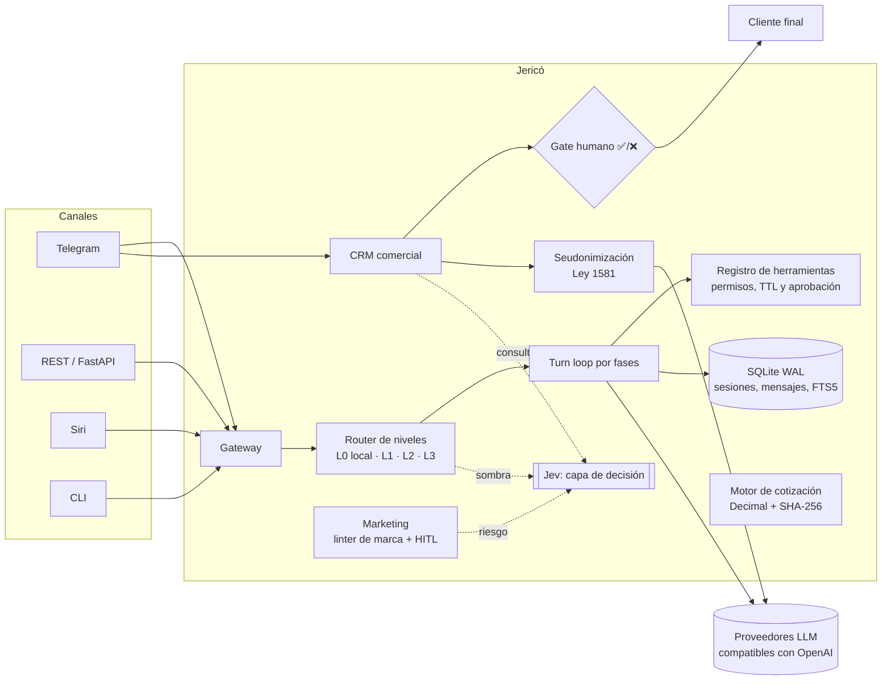
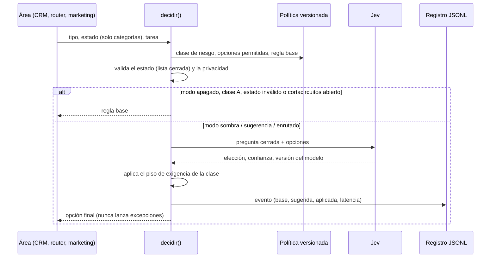

<p align="center">
  
</p>

<h3 align="center">Sistema operativo de IA para una pyme: CRM, cotización, marketing y una capa de decisión auditada.</h3>

<p align="center">
  <a href="https://github.com/kaisen-ai-skynet/Proyecto_Jerico/actions/workflows/ci.yml"></a>
  
  
  
  
  
  
</p>

<p align="center">
  <a href="#jericó-en-30-segundos">Resumen</a> ·
  <a href="#arquitectura">Arquitectura</a> ·
  <a href="#jev-la-capa-de-decisión">Jev</a> ·
  <a href="#cómo-se-construyó">Método</a> ·
  <a href="#inicio-rápido">Inicio rápido</a> ·
  <a href="docs/GUIA_EVALUADORES.md">Guía para evaluadores</a>
</p>

---

## Jericó en 30 segundos

Jericó es el asistente y la plataforma interna de **Kaizen**, una empresa de automatización para pymes en Bogotá. Lo diseñé y construí como líder técnico para resolver un problema concreto: **un equipo pequeño que vende, cotiza y hace seguimiento a mano, y que quiere usar IA sin perder el control ni violar la Ley 1581 de protección de datos.**

La regla que guía todo el diseño es **«la IA propone, el código decide, el humano aprueba»**:

- Ningún mensaje sale a un cliente sin que una persona pulse ✅ sobre esa versión exacta del texto.
- Los precios los calcula un motor determinista con `Decimal`, nunca un modelo de lenguaje.
- Los datos personales se seudonimizan antes de llegar a cualquier proveedor de IA.
- Cada decisión automática tiene una regla fija de respaldo, queda registrada y se puede medir.

| | |
|---|---|
| **Código** | ~27 000 líneas de Python en `src/`, ~36 000 líneas de pruebas |
| **Calidad** | 2248 pruebas herméticas, 96 % de cobertura (mínimo exigido en CI: 89 %), ruff + pre-commit |
| **Especificación** | 8 specs con más de 300 requisitos trazables (formato EARS), cada uno con su prueba |
| **En producción** | El CRM comercial corre en el servidor de Kaizen (Docker, respaldos cifrados con `age`) |
| **Periodo** | Septiembre–octubre de 2026, 170+ commits |

> **English summary:** Jericó is a production-minded AI operations platform for a small Colombian automation company. It includes a Telegram-based CRM with human approval gates, a deterministic pricing engine, a marketing pipeline with a brand linter, a modular agent turn loop, and **Jev**, a decision layer that runs in shadow mode with fixed fallbacks, privacy checks, a circuit breaker and calibration metrics (Brier/ECE) before it is ever allowed to route real traffic. 2,248 hermetic tests, 96% coverage, spec-driven development with traceable requirements.

---

## Qué hace

| Módulo | Qué resuelve | Piezas clave |
|---|---|---|
| **CRM comercial** (`crm/`) | Alta de leads, cadencias de seguimiento, bandeja de correo, cierre con contrato y firma electrónica | Bot de Telegram por roles, gate ✅/❌, outbox con reintentos 0/1/5 min, idempotencia determinista, DocuSeal autoalojado, cumplimiento Ley 1581 (autorización, baja, retención) |
| **Asistente comercial** (`crm/assistant.py`) | Resume leads, redacta borradores y responde dudas del pipeline | Seudonimización previa, tope diario de tokens y de costo en USD, nunca envía al cliente por sí mismo |
| **Catálogo y cotización** (`catalogo/`) | Cotizaciones exactas y versionadas | Motor con `Decimal`, verificador contra el modelo financiero en Excel con huella SHA-256 y alertas de precio bajo costo |
| **Marketing** (`marketing/`) | Piezas para correo, WhatsApp, redes y Meta Ads | Linter determinista de marca, orquestador con aprobación humana, `DRY_RUN` por defecto, cero gasto sin orden explícita |
| **Jev — capa de decisión** (`decision/`) | Decidir qué modelo, qué ruta o qué nivel de revisión usar, y ahorrar tokens sin perder seguridad | Modos apagado → sombra → sugerencia → enrutado, política versionada, cortacircuitos, caché, métricas de calibración. [Ver sección](#jev-la-capa-de-decisión) |
| **Núcleo agéntico** (`agent/`, `state/`, `tools/`) | Ciclo de turnos de un agente sin frameworks externos | Turn loop por fases (preflight → ensamblado → llamada → herramientas → cierre), compactación de contexto, PromptBuilder inmutable por hash SHA-256, SQLite WAL + FTS5 |
| **Gateway** (`gateway/`, `api.py`) | Un mismo cerebro en varios canales | REST (FastAPI), Telegram, Siri (atajos de iOS) y CLI; voz con faster-whisper |

---

## Arquitectura



**Decisiones de arquitectura que vale la pena mirar** (todas documentadas en [`docs/decisiones/`](docs/decisiones/) y [`DECISIONES_CTO.md`](DECISIONES_CTO.md)):

1. **Cero frameworks monolíticos.** LangChain y LlamaIndex están prohibidos por la [constitución](docs/constitution.md). El turn loop está partido en fases pequeñas y probadas por separado, para entender y depurar cada paso.
2. **Puertos y adaptadores.** La firma electrónica (`SignaturePort`), el correo, Telegram y Jev se usan a través de interfaces. Eso permite probarlo todo sin red y cambiar de proveedor sin tocar la lógica.
3. **Efectos externos seguros.** Toda acción que sale de la máquina reserva primero una clave idempotente y pasa por una *outbox* persistida antes del primer intento. Si el proceso se cae, nada se envía dos veces ni se pierde.
4. **Infraestructura austera.** Diseñado para correr en un VPS pequeño o en Oracle Cloud Free Tier (ARM64): SQLite WAL con SQL portable a PostgreSQL 16, Redis opcional, acceso por Tailscale y API en `127.0.0.1`.
5. **Modelos pineados.** Nada de alias flotantes como `-latest`. Los prompts de sistema se identifican por hash para saber qué versión respondió.

---

## Jev: la capa de decisión

Jev es un modelo de decisión externo: no redacta texto, **elige entre opciones cerradas** y devuelve probabilidades. En Jericó lo uso para decidir, por ejemplo, qué modelo atiende una tarea del asistente o si un turno necesita más revisión. La idea es ahorrar tokens y dinero sin entregar el control.

Lo interesante no es llamar a una API, sino **cómo se le pone límites**:



- **Clases de riesgo.** En la clase A (legal, dinero, irreversible), Jev no decide nada. En la clase B, Jev solo puede *subir* la exigencia, por ejemplo pedir aprobación humana o un modelo mejor, nunca bajarla. En la clase C (tareas internas sin datos personales), puede elegir libremente entre las opciones permitidas.
- **Promoción con evidencia.** Un tipo de decisión pasa de *sombra* a *sugerencia* y luego a *enrutado* solo con 200 o más decisiones registradas, p95 de latencia ≤ 1 s para enrutar y la orden explícita del CTO. El evaluador reporta además la calibración (Brier score y ECE).
- **Privacidad por diseño.** Jev solo recibe categorías y contadores. Un validador rechaza cualquier estado que parezca llevar un correo o un número largo antes de que salga de la máquina.
- **Tolerancia a fallos.** Hay un cortacircuitos (3 fallos → 5 min abierto), caché con *single-flight*, *timeout* configurable y un interruptor global (`JERICO_DECISION_KILL`).

📖 Detalle completo en **[`docs/JEV.md`](docs/JEV.md)** · Specs: [`002`](specs/002-jev-router-sombra/spec.md), [`007`](specs/007-jev-transversal/spec.md) · Código: [`src/jerico/decision/`](src/jerico/decision/) · 119 pruebas dedicadas.

---

## Cómo se construyó

Jericó se desarrolla con **Spec-Driven Development** y agentes de código supervisados, con reglas estrictas:

```
constitución  →  spec (requisitos EARS)  →  plan  →  tareas atómicas  →  prueba primero  →  código  →  verify.sh
```

- **[Constitución](docs/constitution.md):** 10 principios innegociables, entre ellos secretos fuera del código, humano en el bucle, ejecución aislada y modelos pineados.
- **[Specs](specs/):** cada funcionalidad tiene `spec.md`, `plan.md` y `tasks.md`. Los requisitos tienen identificador (`VCRM-036`, `VJT-030`…) y las pruebas los citan, para que cada regla se pueda rastrear hasta su test.
- **Pruebas herméticas:** red, LLM y servicios externos siempre simulados; los relojes se inyectan para probar cadencias y fechas sin esperar.
- **CI en GitHub Actions:** `pre-commit` (ruff, formato, higiene) y `scripts/verify.sh` con cobertura mínima del 89 %.
- **Agentes como equipo:** [`AGENTS.md`](AGENTS.md), [`MEMORY.md`](MEMORY.md) y los roles en `.claude/agents/` definen cómo trabajan los agentes de código. Ellos implementan tareas acotadas; yo defino la spec, reviso y apruebo cada commit.

---

## Inicio rápido

**Requisitos:** Python 3.12+ (Docker es opcional).

```bash
git clone https://github.com/kaisen-ai-skynet/Proyecto_Jerico.git
cd Proyecto_Jerico
python -m venv .venv && source .venv/bin/activate
pip install -e ".[dev]"

# Toda la suite: no necesita llaves ni red (todo está simulado)
pytest -q

# Verificación completa, igual que en CI (lint + pruebas + cobertura)
./scripts/verify.sh
```

Para usar el asistente con un modelo real:

```bash
cp .env.example .env      # completa JERICO_LLM_BASE_URL y JERICO_LLM_API_KEY
python -m jerico ask --verbose "Resume el estado del pipeline"   # imprime nivel y modelo elegidos
python -m jerico serve                                            # API en http://127.0.0.1:8000 (/health, /api/v1/ask)
docker compose up                                                 # API + Redis
```

El CRM tiene su propio punto de entrada (`jerico-crm`) y su guía de despliegue en [`docs/despliegue-servidor-kaisen.md`](docs/despliegue-servidor-kaisen.md).

---

## Estructura del repositorio

```text
src/jerico/
├── agent/        Turn loop por fases, compactación de contexto, PromptBuilder
├── crm/          CRM comercial: leads, cadencias, gate, outbox, cierre, firma, cumplimiento
├── catalogo/     Motor de cotización y verificador del catálogo
├── decision/     Jev: política, puerto decidir(), cortacircuitos, caché, evaluador
├── marketing/    Plantillas, linter de marca, orquestador y adaptadores por canal
├── gateway/      REST, Telegram, Siri y CLI
├── state/        SQLite WAL, mensajes, FTS5, leases
├── tools/        Registro de herramientas, permisos, aprobación, entornos aislados
├── skills/       Carga, validación y curaduría de habilidades
├── shadowlog/    Registros JSONL diarios con retención
└── voice/        Transcripción (faster-whisper) y síntesis
specs/            001–008: specs, planes y tareas
docs/             Arquitectura, decisiones, despliegue, Jev, marca e informes
tests/            136 módulos de prueba
deploy/, scripts/ Docker Compose, systemd, respaldos y aprovisionamiento de VPS
```

---

## Estado y hoja de ruta

| Componente | Estado |
|---|---|
| CRM comercial (spec 001) y asistente | ✅ En producción en el servidor de Kaizen |
| Cierre, contrato y firma (spec 004) | ✅ Implementado y con pruebas |
| Catálogo y cotización (spec 006) | ✅ Implementado y con pruebas |
| Marketing y marca (spec 008) | ✅ Implementado en `DRY_RUN` |
| Jev transversal (spec 007) | 🟡 Implementado; en modo sombra o sugerencia, acumulando evidencia |
| Núcleo agéntico y router (spec 002) | 🟡 Implementado; pendiente de desplegar en Oracle Cloud |
| Asistente Hermes con voz y PWA (spec 005) | 🔵 Especificado |

Soy transparente con el estado porque también es parte del diseño: nada pasa a producción ni toma el control sin evidencia medida.

---

## Autor

**Juan Santiago González Marín**: fundador y líder técnico de Kaizen. Bogotá, Colombia.
Automatización de procesos e IA aplicada · Python · FastAPI · n8n · PostgreSQL · Docker.

- Correo: [juansantiagogonzalezmarin@gmail.com](mailto:juansantiagogonzalezmarin@gmail.com)
- LinkedIn: [juan-santiago-gonzález-marín](https://www.linkedin.com/in/juan-santiago-gonz%C3%A1lez-mar%C3%ADn-4260a1217)
- GitHub: [kaisen-ai-skynet](https://github.com/kaisen-ai-skynet)

¿Evalúas este repositorio para una vacante? Empieza por la **[guía para evaluadores](docs/GUIA_EVALUADORES.md)**: es un recorrido de 10 minutos por las partes que mejor muestran cómo trabajo.

---

<sub>© 2026 Kaizen. Código publicado como portafolio técnico; todos los derechos reservados. Los datos de clientes no forman parte de este repositorio: las pruebas usan datos sintéticos.</sub>
