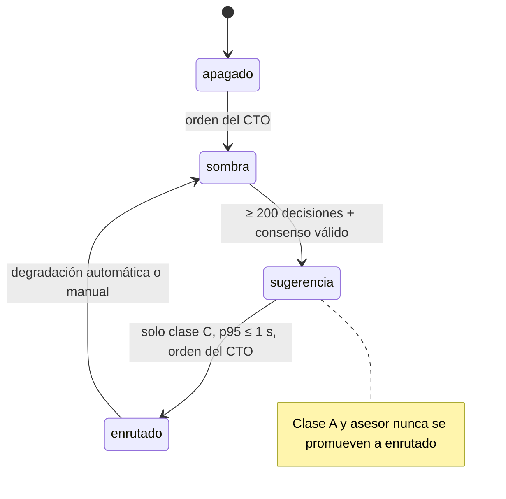

# Jev: capa de decisión de Jericó

> Resumen técnico de la spec [007](../specs/007-jev-transversal/spec.md) y de su implementación en [`src/jerico/decision/`](../src/jerico/decision/). Para la operación en producción, ver [`despliegue-decision-jev.md`](despliegue-decision-jev.md).

## El problema

Jericó usa varios modelos de lenguaje con costos muy distintos. Mandar todo al modelo más caro es seguro pero caro; mandar todo al más barato ahorra, pero arriesga calidad y privacidad. También hay decisiones operativas (¿este turno es de alto riesgo?, ¿hay que pedir aprobación humana?, ¿qué lead se contacta primero?) que hoy resuelven reglas fijas con debilidades conocidas.

**Jev** (de TypeSafe AI, versión pineada `jev-1.13.0`) es un modelo de decisión: no redacta texto, elige entre opciones cerradas y devuelve una confianza. La pregunta de ingeniería no es *cómo llamarlo*, sino **cómo dejar que tome decisiones sin que un error suyo pueda costar dinero, filtrar datos o saltarse una aprobación**.

## Principios

1. **La IA propone, el código decide.** Jev elige solo entre opciones que el código ya calculó como permitidas. Nunca ejecuta una acción ni ve datos de clientes.
2. **Siempre hay regla de respaldo.** Si Jev falla, tarda o responde algo inválido, se aplica la regla fija.
3. **Primero sombra.** Jev opina y manda la regla. Solo toma el control de un tipo de decisión con evidencia medida y con orden del CTO para ese tipo.
4. **La confianza no se da por calibrada:** se mide antes de usarla como umbral.
5. **Solo categorías y contadores** viajan a Jev: nada de texto libre ni identificadores.

## Interfaz única

Todas las áreas usan una sola función:

```python
from jerico.decision.port import decidir

decision = decidir(
    "modelo_asistente",
    state={"tipo_tarea": "resumen_lead", "longitud_contexto": "media"},
    tarea="resumen_lead",
)
decision.option  # opción final que se aplica
decision.source  # "base", "jev", "cache"…
decision.reason  # por qué (estado inválido, clase A, cortacircuitos…)
decision.suggested  # lo que propuso Jev (en modo sugerencia)
```

`decidir()` **nunca lanza excepciones** al invocador (requisito VJT-030). Ante cualquier error, devuelve la regla base con el motivo.

## Clases de riesgo

| Clase | Ejemplos | Qué puede hacer Jev |
|---|---|---|
| **A**: legal, dinero, irreversible | Bajas por Ley 1581, contratos, precios, enviar a un cliente | **Nada.** Decide la regla fija. |
| **B**: crítica con regla base | Texto que lee el cliente, nivel de riesgo del turno, pedir aprobación humana | **Solo subir** la exigencia, según un orden declarado en la política. Nunca bajarla. |
| **C**: ligera e interna | Clasificar, resumir, elegir habilidad o un modelo más barato | Elegir entre las opciones permitidas, solo con datos sin información personal o seudonimizados y verificados. |
| **Asesor** | Seguimiento de leads | Solo se registra. Nunca se aplica automáticamente. |

La clase pertenece al par *(tipo, tarea)* y se fija en la política, no en la respuesta de Jev. El «piso de exigencia» ([`floor.py`](../src/jerico/decision/floor.py)) aplica además la clase de datos más restrictiva entre todas las fuentes.

## Tipos de decisión configurados

Definidos en [`policy.json`](../src/jerico/decision/policy.json) (versionada; si cambia la versión, se invalida la caché):

| Tipo | Clase | Regla base | Opciones |
|---|---|---|---|
| `modelo_asistente` | C (B para borradores al cliente) | `gpt-6-luna` | deepseek-chat, gemini-3.8-flash, gpt-6-luna, claude-opus-5.5 |
| `nivel_turno` | B | L1 | L1, L2, L3 |
| `escalar_humano` | B | `pedir` | no_pedir, pedir |
| `riesgo_pieza` (marketing) | B | `alto` | bajo, moderado, alto |
| `ruta_consulta_financiera` | B | `herramienta` | conceptual, herramienta, humano |
| `siguiente_paso_voz` | B | `pasar_humano` | continuar, pasar_humano |
| `habilidad` | C | `general` | crm, finanzas, marketing, general |
| `seguimiento_lead` | A, asesor | `mantener_orden` | mantener_orden, contactar_hoy, esperar_cadencia, pedir_autorizacion, marcar_inactivo |

Todos arrancan en modo `apagado`: el comportamiento por defecto es exactamente el de las reglas.

## Flujo de una decisión

1. **Política:** se resuelve la clase, la regla base y las opciones del par *(tipo, tarea)*.
2. **Validación estricta del estado** ([`state.py`](../src/jerico/decision/state.py)): lista cerrada de claves y valores. Una clave extra, faltante o con un valor no enumerado devuelve la regla base, y no se registra ni se envía nada.
3. **Interruptores:** `JERICO_DECISION_KILL`, modo `apagado`, clase A o un tipo degradado devuelven la regla base sin tocar la red.
4. **Caché + single-flight** ([`cache.py`](../src/jerico/decision/cache.py)): una misma pregunta con el mismo estado y la misma versión de política no se consulta dos veces, ni siquiera de forma concurrente.
5. **Cortacircuitos** ([`breaker.py`](../src/jerico/decision/breaker.py)): con 3 fallos seguidos se abre durante 300 s.
6. **Cliente Jev** ([`jev_client.py`](../src/jerico/decision/jev_client.py)): solo biblioteca estándar, *timeout* de 3 s, validación de privacidad previa (rechaza correos y números de 9 o más dígitos), llave leída del entorno y nunca impresa (`__repr__` y los mensajes de error están saneados).
7. **Piso de exigencia:** en clase B, si Jev propone algo menos exigente que la regla, se descarta.
8. **Registro** ([`recorder.py`](../src/jerico/decision/recorder.py)): un evento JSONL por decisión, con base, sugerencia, opción aplicada, latencia y versión del modelo. Retención de 90 días.

## Modos y promoción



- **Sombra:** Jev responde y se registra; manda la regla.
- **Sugerencia:** el CTO ve la propuesta de Jev junto a la regla, por ejemplo en el bot del CRM.
- **Enrutado:** la opción de Jev se aplica, dentro del conjunto permitido y del piso de su clase.

El [evaluador](../src/jerico/decision/evaluator.py) calcula la tasa de acuerdo con la regla, el **Brier score**, el **ECE** (error de calibración esperado) y el **p95 de latencia**, y decide si un tipo cumple los criterios de volumen, latencia y clase. Las métricas de calibración se reportan junto a cada evaluación para que el CTO decida con datos. La medición previa en la flota mostró un ECE de 0,33 para la pregunta de modelo y de 0,08 para la de revisión de seguridad. Por eso la confianza de Jev no se usa como umbral sin medirla antes en el propio contexto.

## Integración con el CRM

El módulo **CRM-consejero** ([`crm/advisor_*.py`](../src/jerico/crm/)) arma una fotografía agregada del pipeline (solo contadores y cubos, sin nombres ni teléfonos) y consulta `seguimiento_lead` en modo asesor. El resultado solo se registra para evaluarlo después. Nunca reordena ni contacta leads por sí mismo.

## Pruebas

119 pruebas en `tests/test_decision_*.py` y `tests/test_crm_advisor_*.py` cubren, entre otros casos:

- un estado inválido o con datos personales nunca sale de la máquina;
- Jev no puede bajar la exigencia en clase B ni decidir en clase A;
- el cortacircuitos se abre y se recupera con un reloj inyectado;
- caídas, *timeouts* o respuestas mal formadas de Jev devuelven la regla base;
- la llave nunca aparece en registros ni en representaciones del cliente;
- los criterios de promoción, con Brier, ECE y p95 calculados sobre datos conocidos.

```bash
pytest -q tests/test_decision_*.py tests/test_crm_advisor_*.py
```
