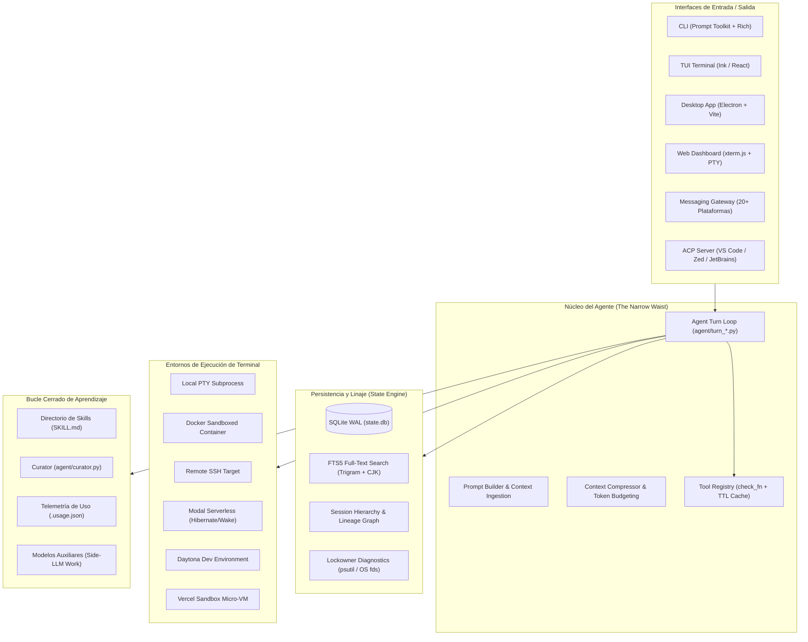
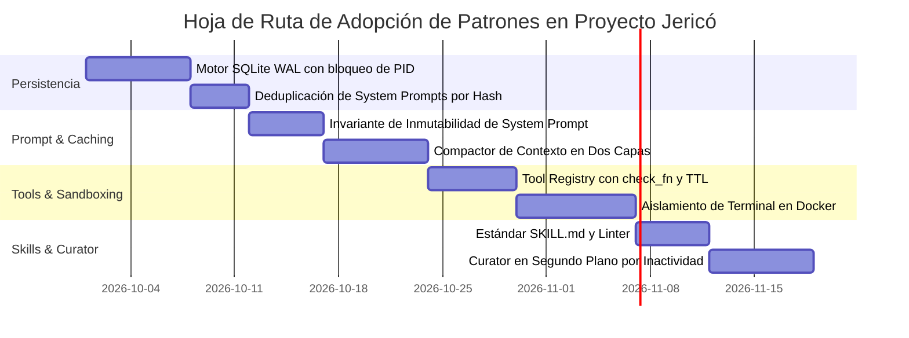

# Arquitectura Maestra de Hermes Agent: Guía Técnica de Referencia y Transferencia

> **Documento de Ingeniería Inversa y Especificación Canónica**  
> **Origen:** [`nousresearch/hermes-agent`](https://github.com/nousresearch/hermes-agent)  
> **Destino:** Proyecto Jericó (AI-OS Kaisen AI)  
> **Fecha:** 29 de septiembre de 2026  
> **Modo:** Solo lectura / Análisis profundo  

---

## 1. Visión General y Filosofía de Diseño

**Hermes Agent ☤** es un agente autónomo de IA desarrollado por **Nous Research** concebido como un sistema **auto-evolutivo con bucle cerrado de aprendizaje (*closed learning loop*)**. 

A diferencia de los agentes tradicionales que dependen de prompts monumentales, sesiones efímeras en RAM o frameworks con dependencias descontroladas, Hermes Agent está construido bajo principios de ingeniería de sistemas de alto rendimiento y resiliencia:



### Los Dos Invariantes Sagrados de Hermes
1. **El Prompt Caching es Sagrado (*Per-conversation prompt caching is sacred*)**:
   - Cada llamada a un LLM moderno reutiliza el prefijo del prompt ya procesado si es idéntico byte por byte (*KV-cache* en el proveedor).
   - Cualquier mutación al *system prompt*, recarga de memoria a mitad de conversación o reordenamiento de herramientas **invalida el caché** y multiplica el coste y latencia por 10x.
   - En Hermes, el *system prompt* es **estricta e inmutablemente idéntico** durante toda la vida de la conversación. Las instrucciones nuevas y skills se inyectan dinámicamente como mensajes de rol `user` o `tool`, nunca en el system prompt.
   - La **única** excepción permitida para romper el caché es la **compresión de contexto**.
2. **Núcleo Estrecho, Capacidades en los Bordes (*Narrow Waist Core*)**:
   - El esquema de cada herramienta registrada se envía en **cada llamada API**.
   - No se añaden herramientas al núcleo si pueden resolverse mediante un subcomando CLI guiado por un `SKILL.md`, una herramienta con compuerta de servicio (`check_fn`), o un servidor MCP.

---

## 2. Pilar 1: El Bucle de Turnos (*Agent Turn Loop*) y Prompt Caching

### 2.1 El Patrón Facade + Siblings
Hermes abandonó los archivos monolíticos ("god-files") en septiembre de 2026. `run_agent.py` es una fachada pública delgada; la ejecución de un turno reside en `agent/conversation_loop.py` dividido en más de 25 fases modulares (`agent/turn_*.py`):

```
agent/
├── conversation_loop.py        # Bucle de orquestación sincrónico
├── turn_preflight.py           # Adquisición de lease de sesión y validación de estado
├── turn_request_assembly.py    # Preparación estricta de mensajes para el proveedor LLM
├── turn_api_call.py            # Ejecución de llamada HTTP/WebSocket con streaming
├── turn_api_error.py           # Clasificación de errores y retries jittered
├── turn_response_intake.py     # Procesamiento del stream e inspección de tool_calls
├── turn_tool_round.py          # Despacho y ejecución de herramientas
├── turn_overflow.py            # Detección de límite de ventana de contexto
├── turn_context_compaction.py  # Algoritmo de compactación de dos capas
├── turn_recovery.py            # Escalera de autorecuperación tras agotamiento
└── turn_finalizer.py           # Cálculo de costos, tokens y persistencia final
```

### 2.2 Ciclo de Ejecución de un Turno
El bucle es completamente **sincrónico**, garantizando determinismo:

```python
while (api_call_count < self.max_iterations and self.iteration_budget.remaining > 0) or self._budget_grace_call:
    if self._interrupt_requested:
        break
        
    # 1. Ensamblado con System Prompt inmutable (preserva Prompt Caching)
    request_payload = build_request(model, messages, tool_schemas)
    
    # 2. Llamada al proveedor (OpenAI, Anthropic, Nous Portal, etc.)
    response = client.chat.completions.create(**request_payload)
    
    # 3. Si hay Tool Calls, ejecutarlas y acumular resultados
    if response.tool_calls:
        for tc in response.tool_calls:
            # Las herramientas inline (todo, memory) se interceptan en RAM
            if tc.name in INLINE_TOOL_EXECUTORS:
                result = INLINE_TOOL_EXECUTORS[tc.name](tc.args)
            else:
                result = handle_function_call(tc.name, tc.args, task_id)
            messages.append(make_tool_result_message(tc.id, result))
        api_call_count += 1
        
        # 4. Verificar umbral de contexto para compresión
        if is_context_overflow(messages, max_window=0.85):
            messages = compact_context(messages, auxiliary_model)
    else:
        # 5. Respuesta final de texto emitida al usuario
        return response.content
```

### 2.3 Compresión de Contexto en Dos Capas (*Context Compactor*)
Cuando la conversación alcanza el 80-85% del contexto máximo:
1. **Capa 1: Podado de bajo costo (*Zero-cost pruning*)**: Se eliminan las salidas voluminosas de herramientas pasadas (ej. volcados de terminales o archivos leídos hace 5 turnos), reemplazándolas por metadatos breves sin realizar ninguna llamada al LLM.
2. **Capa 2: Resumen Estructurado Auxiliar**: Un modelo secundario especializado (*auxiliary compression model*) resume los turnos de diálogo intermedios. Se rota la sesión en la base de datos conservando `parent_session_id`, logrando continuidad infinita con costo acotado.

---

## 3. Pilar 2: Motor de Persistencia SQLite WAL y Diagnóstico de Bloqueos

### 3.1 Esquema Relacional de `state.db`
La base de datos opera bajo `PRAGMA journal_mode=WAL`, `PRAGMA busy_timeout=60000` y `PRAGMA synchronous=NORMAL`. Conexiones de lectura concurrentes se gestionan mediante un pool (`hermes_state_readpool.py`).

```sql
-- Deduplicación de System Prompts por Hash SHA256
CREATE TABLE IF NOT EXISTS system_prompts (
    hash TEXT PRIMARY KEY,
    prompt TEXT NOT NULL
);

-- Jerarquía y Linaje de Sesiones
CREATE TABLE IF NOT EXISTS sessions (
    id TEXT PRIMARY KEY,
    source TEXT NOT NULL,                     -- 'cli', 'telegram', 'desktop', etc.
    session_key TEXT,
    parent_session_id TEXT REFERENCES sessions(id),
    model TEXT,
    system_prompt_hash TEXT REFERENCES system_prompts(hash),
    started_at REAL NOT NULL,
    ended_at REAL,
    end_reason TEXT,                          -- 'compression', 'branched', 'session_reset', etc.
    message_count INTEGER DEFAULT 0,
    tool_call_count INTEGER DEFAULT 0,
    input_tokens INTEGER DEFAULT 0,
    output_tokens INTEGER DEFAULT 0,
    cache_read_tokens INTEGER DEFAULT 0,
    cache_write_tokens INTEGER DEFAULT 0,
    reasoning_tokens INTEGER DEFAULT 0,
    cwd TEXT,
    git_branch TEXT,
    git_repo_root TEXT,
    billing_provider TEXT,
    estimated_cost_usd REAL,
    actual_cost_usd REAL,
    title TEXT,
    profile_name TEXT
);

-- Historial Append-Only de Mensajes
CREATE TABLE IF NOT EXISTS messages (
    id INTEGER PRIMARY KEY AUTOINCREMENT,
    session_id TEXT NOT NULL REFERENCES sessions(id),
    role TEXT NOT NULL,                       -- 'system', 'user', 'assistant', 'tool'
    content TEXT,
    tool_call_id TEXT,
    tool_calls TEXT,                          -- JSON serializado de llamadas
    tool_name TEXT,
    timestamp REAL NOT NULL,
    token_count INTEGER,
    reasoning TEXT,                           -- Pensamiento del modelo (CoT)
    message_uid TEXT,
    display_kind TEXT                         -- 'normal', 'hidden' (scaffolding interno)
);

-- Contabilidad Detallada de Consumo por Modelo y Tarea
CREATE TABLE IF NOT EXISTS session_model_usage (
    session_id TEXT NOT NULL REFERENCES sessions(id) ON DELETE CASCADE,
    model TEXT NOT NULL,
    billing_provider TEXT NOT NULL DEFAULT '',
    task TEXT NOT NULL DEFAULT '',
    api_call_count INTEGER NOT NULL DEFAULT 0,
    input_tokens INTEGER NOT NULL DEFAULT 0,
    output_tokens INTEGER NOT NULL DEFAULT 0,
    cache_read_tokens INTEGER NOT NULL DEFAULT 0,
    cache_write_tokens INTEGER NOT NULL DEFAULT 0,
    estimated_cost_usd REAL NOT NULL DEFAULT 0,
    PRIMARY KEY (session_id, model, billing_provider, task)
);

-- Índice de Búsqueda de Texto Completo FTS5 con Tokenizador Trigram
CREATE VIRTUAL TABLE IF NOT EXISTS messages_fts USING fts5(
    content,
    content='messages',
    content_rowid='id',
    tokenize='trigram'
);
```

### 3.2 Diagnóstico de Bloqueos de Base de Datos en Tiempo Real
Cuando múltiples procesos (CLI, TUI, Gateway, Cron) intentan escribir concurrentemente y SQLite arroja `sqlite3.OperationalError: database is locked`, `hermes_state_lockowners.py` activa un escáner forense:
1. Inspecciona los descriptores de archivo en `/proc/<pid>/fd` (Linux) o utiliza la API nativa de Windows `RestartManager` / `handle.exe`.
2. Cruza los PIDs detectados con `psutil.Process(pid)`.
3. Registra en el log exactamente qué comando está reteniendo el bloqueo:
   ```text
   WARNING: SQLite write lock contention on state.db!
   Lock holder: PID 45122 (/home/user/.hermes/venv/bin/python hermes gateway run)
   Command line: ['python', 'gateway/run.py', '--profile', 'default']
   Waiting for lease release...
   ```

---

## 4. Pilar 3: Sistema de Habilidades Autónomas (*Skills*) y el Curador (*Curator*)

### 4.1 Anatomía de una Habilidad (`SKILL.md`)
Cada habilidad es un paquete autónomo dentro de `skills/<categoría>/<nombre_skill>/`. Contiene obligatoriamente `SKILL.md` y opcionalmente scripts auxiliares (`scripts/`), referencias (`references/`) y plantillas (`templates/`).

#### Estándares HARDLINE de Autoría (Validados por Linter):
1. **Descripción concisa**: Máximo 60 caracteres, una sola oración, terminada en punto.
2. **Uso de herramientas nativas**: Las instrucciones deben invocar las herramientas de Hermes en comillas invertidas (`terminal`, `read_file`, `patch`, `search_files`, `browser_navigate`) y **nunca** herramientas de shell genéricas (`cat`, `sed`, `grep`).
3. **Auditoría de portabilidad multiplataforma**: Primitivas exclusivas de POSIX (`/tmp`, `fcntl`, `os.setsid`, `signal.SIGKILL`) exigen declarar `platforms: [linux]`. De lo contrario, deben usar `tempfile.gettempdir()`, `pathlib.Path` y `psutil`.

Ejemplo canónico de `SKILL.md`:
```markdown
---
name: systematic-debugging
description: Use when encountering any bug or test failure before fixing.
version: 1.0.0
author: Santiago Gonzalez <kaisen.ai@example.com>
license: MIT
platforms: [any]
metadata:
  hermes:
    tags: [debugging, testing, root-cause]
    category: software-development
---

# Systematic Debugging Skill

Use this skill when encountering test failures or unexplained bugs.

## When to Use
- When a test fails in the test suite.
- Before proposing any code modification or fix.

## Procedure
1. Reproduce the failure with `terminal`.
2. Inspect the stack trace using `read_file`.
3. Locate root cause before editing with `patch`.
4. Run verification with `terminal`.
```

### 4.2 El Curador Autónomo (`agent/curator.py`)
El *Curator* es el responsable del **bucle de auto-mejora continua**:
* **Disparo por inactividad**: No consume CPU innecesariamente; se ejecuta solo cuando el agente lleva inactivo más de `min_idle_hours = 2` y el último escaneo tiene más de `interval_hours = 168` (7 días).
* **Telemetría de uso (`skills/.usage.json`)**: Registra automáticamente cada vez que una habilidad es vista, usada o parcheada.
* **Transiciones de ciclo de vida**:
  - `active` $\rightarrow$ `stale` (14 días sin invocación).
  - `stale` $\rightarrow$ `archived` (30 días sin invocación; se mueve a `skills/.archive/`, nunca se destruye).
  - Habilidades marcadas con `pinned: true` están completamente blindadas.
* **Consolidación con LLM Auxiliar**: Durante la inactividad, puede lanzar una sesión secundaria en segundo plano para fusionar habilidades similares o refinar procedimientos basados en fallos previos.

---

## 5. Pilar 4: Catálogo Maestro de Herramientas, Toolsets y Entornos

### 5.1 Herramientas Centrales del Núcleo (`_HERMES_CORE_TOOLS`)

| Categoría | Nombre de Herramienta | Descripción y Propósito |
| :--- | :--- | :--- |
| **Archivos y Código** | `read_file` | Lectura de archivos con extracción automática de PDF, Office y RTF a Markdown vía `firecrawl-anydoc`. |
| | `write_file` | Escritura atómica de archivos con salvaguardas de directorio. |
| | `patch` | Edición quirúrgica de bloques de código con coincidencia difusa (*fuzzy matching*). |
| | `search_files` | Búsqueda ultrarrápida de nombres de archivos y patrones de texto basada en ripgrep / BM25. |
| | `execute_code` | Ejecución de scripts locales en Python que llaman a herramientas por RPC, reduciendo llamadas al LLM a coste cero. |
| **Terminal y Procesos** | `terminal` | Ejecución de comandos bash/zsh/PowerShell con soporte interactivo y en segundo plano. |
| | `process_manage` | Control de procesos en background (kill, status, attach, log drain). Señaliza primero al padre (`SIGTERM`) antes de matar descendientes. |
| **Navegación Web** | `web_search` | Búsqueda web desacoplada (backends: Exa, Firecrawl, Parallel, DDG). |
| | `web_extract` | Scrapeo y conversión de páginas web a Markdown limpio. |
| | `browser_navigate` | Control de Chromium vía CDP para navegación real. |
| | `browser_snapshot` | Captura de accesibilidad DOM estructurada. |
| | `browser_click` / `type` | Interacción sintética con elementos de página. |
| | `browser_vault_*` | Gestor de credenciales local cifrado para auto-completar logins sin exponer contraseñas en el chat. |
| **Visión y Audio** | `vision_analyze` | Análisis visual multirresolución con re-escalado automático y soporte para HEIC/AVIF. |
| | `image_generate` | Generación de imágenes (backends: FAL, Midjourney wrapper). |
| | `video_generate` | Generación de vídeo texto-a-vídeo e imagen-a-vídeo. |
| | `text_to_speech` | Síntesis de voz (backends: Edge-TTS, ElevenLabs, OpenAI, Piper). |
| **Orquestación y Memoria** | `todo_list` | Seguimiento visual de tareas complejas en RAM (inline, interceptado antes del dispatch). |
| | `memory` | Almacenamiento y recuperación de perfiles de usuario y notas permanentes. |
| | `session_search` | Búsqueda semántica y FTS5 en sesiones históricas con resumen mediante LLM auxiliar. |
| | `clarify` | Interfaz interactiva de preguntas múltiples al usuario para despejar ambigüedades. |
| | `delegate_task` | Despacho de subagentes en paralelo con terminales aislados y traspaso ordenado de procesos. |
| **Integraciones** | `cronjob_manage` | Creación y administración de tareas programadas en lenguaje natural o 5-field cron. |
| | `ha_*` | Integración nativa con Home Assistant (entidades, estados y servicios). |
| | `kanban_*` | Coordinación multi-agente en tableros de tareas compartidos. |

### 5.2 Los 7 Entornos de Ejecución de Terminal (`tools/environments/`)
Hermes no asume que el comando se ejecuta en la máquina local:
1. **`local.py`**: Subprocesos locales con asignación de pseudo-terminal (PTY) y herencia higiénica de variables de entorno (`served_profile_child_env`).
2. **`docker.py`**: Contenedores Docker efímeros o persistentes con montaje de volúmenes y reglas estrictas de egress de red.
3. **`ssh.py`**: Ejecución remota sobre servidores SSH con multiplexación de conexiones.
4. **`singularity.py`**: Contenedores para entornos científicos y clusters HPC sin privilegios de superusuario.
5. **`modal.py`**: Sandboxes serverless en Modal que hibernan automáticamente cuando están inactivos (coste casi nulo en reposo) y despiertan en segundos.
6. **`daytona.py`**: Espacios de trabajo de desarrollo en la nube Daytona.
7. **`vercel_sandbox.py`**: Micro-VMs serverless de Vercel para pruebas rápidas de código web.

---

## 6. Inventario Completo de Skills en Hermes Agent

### 6.1 Habilidades Incorporadas Activas (`skills/`)

```
skills/
├── apple/                      # Integración macOS/iOS
│   ├── apple-notes             # Lectura y creación en Notas de Apple
│   ├── apple-reminders         # Gestión de recordatorios nativos
│   ├── findmy                  # Geolocalización de dispositivos vía Find My
│   └── imessage                # Envío y lectura de iMessage
├── autonomous-ai-agents/       # Control e inspección de otros agentes
│   ├── claude-code             # Ejecución y supervisión de Claude Code CLI
│   ├── codex                   # Integración con OpenAI Codex
│   ├── computer-use            # Control del cursor y pantalla mediante CUA
│   ├── hermes-agent            # Meta-operaciones del propio Hermes
│   └── opencode                # Operaciones con OpenCode
├── creative/                   # Diseño, medios y creatividad
│   ├── architecture-diagram    # Generación de diagramas Mermaid y ASCII
│   ├── ascii-video             # Conversión de vídeo a arte ASCII
│   ├── baoyu-infographic       # Infografías estilizadas
│   ├── claude-design           # Especificaciones de diseño UI
│   ├── humanizer               # Reescribe texto para evitar detección de IA
│   ├── manim-video             # Animaciones matemáticas con Manim
│   └── popular-web-designs     # Patrones de landing pages modernas
├── devops/                     # Operaciones y CI/CD
│   └── sdlc-review             # Revisión formal del ciclo de vida del software
├── email/                      # Gestión de correo electrónico
│   ├── email-inbox-triage      # Clasificación automática de buzón
│   └── himalaya                # Cliente de terminal CLI para IMAP/SMTP
├── media/                      # Vídeo y audio
│   ├── gif-search              # Búsqueda y optimización de GIFs
│   └── youtube-content         # Extracción de transcripciones y resúmenes
├── note-taking/                # Gestión de conocimiento
│   └── obsidian                # Lectura y edición de vaults de Obsidian
├── productivity/               # Suites de productividad
│   ├── airtable                # Consultas y mutaciones en bases Airtable
│   ├── box                     # Almacenamiento en la nube Box
│   ├── docx                    # Procesamiento y generación de Word
│   ├── google-workspace        # Docs, Sheets, Drive y Calendar
│   ├── notion                  # Gestión de bases de datos y páginas Notion
│   ├── pdf                     # Extracción y generación de PDFs vectoriales
│   ├── powerpoint              # Presentaciones automáticas PPTX
│   └── xlsx                    # Hojas de cálculo Excel con fórmulas
├── research/                   # Investigación científica y web
│   ├── arxiv                   # Búsqueda y descarga de papers en arXiv
│   ├── competitor-news-monitor # Monitor de competidores y noticias
│   ├── grounded-citations      # Formato de citas rigurosas y verificables
│   └── llm-wiki                # Construcción de base de conocimiento local
├── social-media/               # Redes sociales
│   └── xurl                    # Cliente autenticado para la API de X (Twitter)
├── software-development/       # Desarrollo e ingeniería de software
│   ├── codebase-inspection     # Escaneo arquitectónico y mapeo de dependencias
│   ├── github                  # Issues, Pull Requests, Reviews y Actions
│   ├── node-inspect-debugger   # Depuración remota de Node.js con inspector V8
│   ├── python-debugpy          # Depuración de procesos Python con debugpy
│   ├── requesting-code-review  # Formato de solicitudes de revisión de código
│   ├── simplify-code           # Refactorización y reducción de complejidad
│   ├── systematic-debugging    # Diagnóstico científico antes de aplicar parches
│   └── test-driven-development # Ciclos Red-Green-Refactor rigurosos
└── web/                        # Navegación y rescate
    └── blocked-page-recovery   # Recuperación ante CAPTCHAs y páginas bloqueadas
```

### 6.2 Habilidades Opcionales bajo Demanda (`optional-skills/`)
Más de 100 habilidades listas para instalar mediante `hermes skills install official/<cat>/<skill>`:
* **Finanzas y Modelado**: `3-statement-model`, `dcf-model`, `lbo-model`, `merger-model`, `stocks`, `polymarket`.
* **MLOps y Modelos**: `accelerate`, `chroma`, `faiss`, `flash-attention`, `instructor`, `lambda-labs`, `peft`, `pytorch-fsdp`, `qdrant`, `tensorrt-llm`, `whisper`.
* **Seguridad Ofensiva/Defensiva**: `1password`, `godmode`, `oss-forensics`, `sherlock`, `web-pentest`.
* **Blockchain / DeFi**: `evm`, `hyperliquid`, `solana`.
* **Desarrollo Web**: `cloudflare-temporary-deploy`, `har-derived-api-client`, `publish-site`, `scrollcraft`.

---

## 7. Hoja de Ruta de Transferencia a Proyecto Jericó

Para elevar la robustez de **Proyecto Jericó** al nivel de los estándares descubiertos en Hermes Agent, se definen las siguientes líneas estratégicas de implementación:



### Acciones Directas Recomendadas:
1. **Sustituir el almacenamiento en memoria de `src/jerico/memory.py` por SQLite WAL (`jerico_state.db`)**:
   - Integrar pragmas WAL y pool de lectura concurrente.
   - Implementar deduplicación de prompts por SHA256.
2. **Aplicar la regla de Prompt Caching en `src/jerico/llm_client.py`**:
   - Congelar el `system prompt` para todos los modelos L0-L3.
   - Traspasar la información de contexto dinámico y fecha/hora a mensajes de rol `user` o `tool`.
3. **Adoptar el estándar de Skills (`SKILL.md`)**:
   - Centralizar las instrucciones operativas de Jericó en habilidades auditadas con descripciones $\le 60$ caracteres y referencias a herramientas nativas.
4. **Implementar el Curador (`Curator`) de Jericó**:
   - Automatizar la telemetría de herramientas y habilidades para detectar qué capacidades dejan de utilizarse y archivarlas limpiamente.
