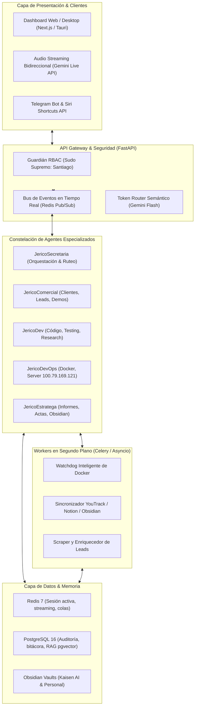
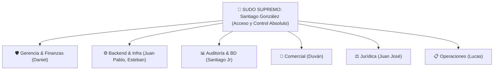

# 🚀 El "Cómo": Arquitectura Técnica, Stack y Plan de Ejecución — Jericó
### Especificación Técnica de Ingeniería para el Asistente y AI-OS de Kaisen AI

---

## 🏗️ 1. Arquitectura General del Sistema

Jericó abandona los grafos monolíticos en n8n y adopta una arquitectura desacoplada basada en micro-servicios, eventos asíncronos y agentes especializados coordinados por un núcleo central de inteligencia.

---

## 💻 2. Stack Tecnológico Seleccionado

| Componente | Tecnología | Justificación Técnica |
| :--- | :--- | :--- |
| **Backend Core** | Python 3.12 + FastAPI + Asyncio | Máxima velocidad asíncrona, soporte nativo de WebSockets y ecosistema maduro de IA. |
| **Modelos de Lenguaje** | Google Gemini 2.5 Flash / Pro + Claude 3.5 Sonnet | Flash para ruteo/clasificación de baja latencia; Pro/Claude para razonamiento técnico profundo y código. |
| **Voz en Tiempo Real** | Gemini Live API / WebRTC | Streaming de audio bidireccional (PCM 24kHz) con latencia <500 ms y soporte de interrupciones naturales. |
| **Frontend / Dashboard** | Next.js 15 / React + Tailwind CSS + Lucide (opcional envoltorio Tauri) | Interfaz visual rica, dashboards en tiempo real mediante WebSockets y visualización reactiva de estados. |
| **Colas y Fondo (Background)** | Redis Streams + Celery / Asyncio Workers | Procesamiento robusto de tareas pesadas en segundo plano sin bloquear el hilo conversacional. |
| **Bases de Datos** | PostgreSQL 16 (`skynet-postgres-1`) + Redis 7 | Estándar empresarial para persistencia relacional con extensión `pgvector` y caché ultra-rápida. |
| **Infraestructura** | Docker Compose + Tailscale | Despliegue reproducible sobre el servidor existente (`100.79.169.121`), aislado por redes privadas. |

---

## 👥 3. Constelación de Micro-Agentes Especializados

Para evitar sobrecargar un solo agente, Jericó opera con agentes desacoplados con contextos delimitados:

### 1. `JericoSecretaria` (Cerebro Central y Ruteador)
* **Función:** Recibir peticiones de cualquier canal (Voz, UI, Telegram), identificar al interlocutor y delegar en el agente correspondiente.
* **Flujo Transversal en Tiempo Real:** Cuando `JericoComercial` interactúa con un cliente, `JericoSecretaria` genera automáticamente un evento que:
  * Envía un resumen ejecutivo a Santiago (CTO).
  * Notifica al área técnica en YouTrack si hay requerimientos de arquitectura.
  * Informa al área administrativa si hay presupuestos o cotizaciones involucradas.

### 2. `JericoComercial` (Frontline y Factoría de Demos)
* **Atención al Cliente:** Chatbot empático y profesional conectado al sitio web o canales de prospección.
* **Calificación de Leads:** Mapeo de presupuesto, tiempos y necesidades técnicas.
* **Generación de Demos:** Capacidad de ensamblar demos parametrizadas (por ejemplo, instancias de prueba del ERP de Mundo de Oro o cotizadores de seguros).

### 3. `JericoDev` (Asistente de Ingeniería de Software)
* **Desarrollo de Código:** Creación de componentes React, endpoints FastAPI, modelos de datos Prisma/SQLAlchemy y migraciones.
* **Investigación Profunda:** Navegación en documentación oficial (vía MCP o APIs), resolución de errores de build y sugerencias de arquitectura limpia.
* **Inventario de Servicios:** Conoce todos los repositorios de la empresa en GitHub (`kaisen-ai-skynet`).

### 4. `JericoDevOps` (SysAdmin y Salud de Servidores)
* **Interacción Directa con Docker:** Conectado al socket de Docker en `desktop-8f1b898`.
* **Supervisión Continua:** Conoce el estado de salud de `skynet-n8n-1`, `segurosbolivar-db`, `mundodeoro-db` y `bolivar-ai-gateway`.
* **Watchdog Inteligente:** No reinicia contenedores por códigos HTTP temporales (corrige el error de `jarvis-salud.sh`).
* **Migraciones Asistidas:** Ejecuta scripts de backup y despliegues con capacidad de rollback inmediato.

### 5. `JericoEstratega` (Documentación y Bases de Conocimiento)
* **Redacción Institucional:** Creación de actas técnicas, propuestas formales en Markdown/PDF y contratos preliminares.
* **Sincronización Viva:** Lee y escribe en las bóvedas de Obsidian (`~/Kaisen_AI/02_Obsidian_Kaisen/`) y actualiza tickets en YouTrack (`https://kaisensky.youtrack.cloud`).

---

## 🛡️ 4. Matriz de Seguridad y Roles (RBAC)

El sistema de seguridad de Jericó implementa una jerarquía estricta basada en roles:

### Privilegios del "Sudo Supremo" (Santiago González):
1. **Canal Seguro Exclusivo:** Reconocimiento biométrico/dispositivo de su estación local (`janty` / `100.89.111.64`) y Telegram ID verificado.
2. **Override Total:** Capacidad de autorizar o abortar cualquier proceso en ejecución.
3. **Escritura No Restringida:** Puede autorizar mutaciones masivas o saltarse la confirmación paso a paso si lo instruye explícitamente.
4. **Acceso Confidencial:** Visualización de métricas financieras de Notion (`DB-07 Finanzas`), contraseñas en memoria e inventario de secretos.

### Protocolo de Confirmación Obligatoria (Para los demás roles):
* Antes de ejecutar mutaciones en YouTrack, bases de datos de clientes o despliegues en Docker, Jericó presenta el resumen:
  `[ACCIÓN PROPUESTA] ➔ [IMPACTO] ➔ [SOLICITUD DE CONFIRMACIÓN (Sí/No)]`.

---

## 📈 5. Plan de Ejecución por Fases (Hoja de Ruta)

### Fase 1: Esqueleto del Núcleo y API Gateway (Semana 1)
- [x] Consolidación de bocetos, especificaciones e inventario de rutas.
- [ ] Estructura base en Python 3.12 con FastAPI en `~/Kaisen_AI/01_Proyectos/Proyecto_Jerico`.
- [ ] Implementación de `TokenRouter` con Gemini 2.5 Flash y autenticación RBAC.
- [ ] Pruebas unitarias de endpoints con `pytest`.

### Fase 2: Portabilidad del Catálogo de Herramientas (Semana 2)
- [ ] Adaptador Python para YouTrack Cloud (`https://kaisensky.youtrack.cloud`).
- [ ] Adaptador Python para Notion API (`DB-01 Sanctum`, `DB-02 Modo Cueva`, `DB-07 Finanzas`).
- [ ] Adaptador Python para Google Calendar y Gmail.
- [ ] Adaptador de monitoreo Docker (Docker SDK para Python).

### Fase 3: Voz Continua y Dashboard Visual (Semana 3)
- [ ] Integración de streaming de voz bidireccional con Gemini Live API.
- [ ] Construcción del Dashboard visual interactivo en Next.js con conexión WebSockets.
- [ ] Invocación por atajo y presencia en segundo plano (daemon).

### Fase 4: Micro-Agentes y Flujo Transversal Comercial (Semana 4)
- [ ] Despliegue de `JericoComercial` con webhook de captación de leads.
- [ ] Bus de eventos para alertas cruzadas (Comercial ➔ Admin ➔ Técnica ➔ Santiago).
- [ ] Activación de `JericoDev` con capacidades de análisis de repositorios locales.

### Fase 5: Despliegue en Producción y Retiro de Jarvis (Semana 5)
- [ ] Creación de `docker-compose.yml` para `jerico-core` en `100.79.169.121`.
- [ ] Verificación de red interna `skynet_skynet_net` y enlace con PostgreSQL y Redis.
- [ ] Desmantelamiento definitivo de los 25 flujos de n8n de Jarvis.

---
> 🕒 **Última modificación:** 20/09/2026 15:25 (Agente Antigravity)
