# 🎨 Boceto y Espacio de Prototipado — Proyecto Jericó
### El Sistema Operativo Inteligente y Secretaria Ejecutiva de Kaisen AI

> **Carpeta de Trabajo y Bocetos:** `~/Kaisen_AI/01_Proyectos/Boceto_jerico`  
> **Repositorio Oficial Git:** `https://github.com/kaisen-ai-skynet/Proyecto_Jerico.git` (`~/Kaisen_AI/01_Proyectos/Proyecto_Jerico`)  
> **Sudo Supremo / CTO:** Santiago Gonzalez (`kaisen.ai.santiago.cto@gmail.com`)

---

## 📌 Propósito de este Directorio
Este espacio consolida la conceptualización completa, el análisis crítico retrospectivo, el ordenamiento de pensamientos y la especificación de ingeniería para el desarrollo de **Jericó**, el nuevo asistente inteligente propio y AI-OS de Kaisen AI (sucesor y evolución de Jarvis).

---

## 📂 Índice y Mapa Documental del Boceto

| Archivo | Rol y Contenido |
| :--- | :--- |
| 🧠 [`ORGANIZACION_IDEAS_Y_VISION.md`](./ORGANIZACION_IDEAS_Y_VISION.md) | **Organización integral de ideas y deseos de Santiago:** Los 9 pilares (Secretaría comercial, UI visual, voz continua, Dev agent, marketing/leads, SysAdmin server, estratega, RBAC Sudo Supremo y memoria masiva). |
| 🔍 [`ANALISIS_CRITICO_JARVIS_VS_JERICO.md`](./ANALISIS_CRITICO_JARVIS_VS_JERICO.md) | **Auditoría retrospectiva de lo construido:** Qué existía (25 flujos de n8n, 38 tools en `jarvis-ops`), por qué colapsó/pausó y el veredicto objetivo: **¿Qué SÍ vale la pena rescatar y qué NO?** |
| 🚀 [`EL_COMO_ARQUITECTURA_Y_PLAN.md`](./EL_COMO_ARQUITECTURA_Y_PLAN.md) | **Especificación del "Cómo":** Stack tecnológico (Python/FastAPI, Gemini Live API, Next.js UI, Redis/Postgres), constelación de micro-agentes, bus de eventos transversal y hoja de ruta en 5 fases. |
| 🏛️ [`ARQUITECTURA.md`](./ARQUITECTURA.md) | Diseño de la arquitectura modular básica (Gateway, Token Router, Orchestrator, Tool Registry, Memoria Redis/Postgres). |
| 📋 [`ESPECIFICACIONES_TECNICAS.md`](./ESPECIFICACIONES_TECNICAS.md) | Catálogo de bases de datos Notion (`DB-01` a `DB-07`), credenciales YouTrack Cloud, servidor `100.79.169.121` y guardrails. |
| 🗺️ [`MAPA_RUTAS_INVENTARIO.md`](./MAPA_RUTAS_INVENTARIO.md) | Mapeo exhaustivo de rutas y archivos de todo el ecosistema (Jarvis vs. Jericó vs. Servidor). |
| 📝 [`PROYECTO_JERICO_OBSIDIAN.md`](./PROYECTO_JERICO_OBSIDIAN.md) | Respaldo de la nota viva alojada en la bóveda de Obsidian (`01_Proyectos/Proyecto_Jerico.md`). |

---

## ⚡ Resumen Ejecutivo de la Transición (Jarvis ➔ Jericó)

```mermaid
flowchart LR
    subgraph JarvisLegado["🔴 Jarvis v1.0 (Legado / Pausado)"]
        J1["25 JSONs monolíticos en n8n"]
        J2["Solo Telegram (sin UI propia)"]
        J3["Voz unidireccional por notas"]
        J4["Sin separación de roles"]
    end

    subgraph Transicion["➡️ Salto Cuántico"]
        T1["Portabilidad de 38 Tools probadas"]
        T2["Rescate de esquemas Notion/DBs"]
    end

    subgraph JericoOS["🟢 Jericó AI-OS (Nuevo Ecosistema)"]
        K1["Backend modular Python/FastAPI"]
        K2["Dashboard WebSockets + Live Voice"]
        K3["Flujo transversal en tiempo real"]
        K4["Constelación de agentes + RBAC Sudo"]
    end

    JarvisLegado --> Transicion --> JericoOS
```

---
> 🕒 **Última modificación:** 20/09/2026 15:25 (Agente Antigravity)
