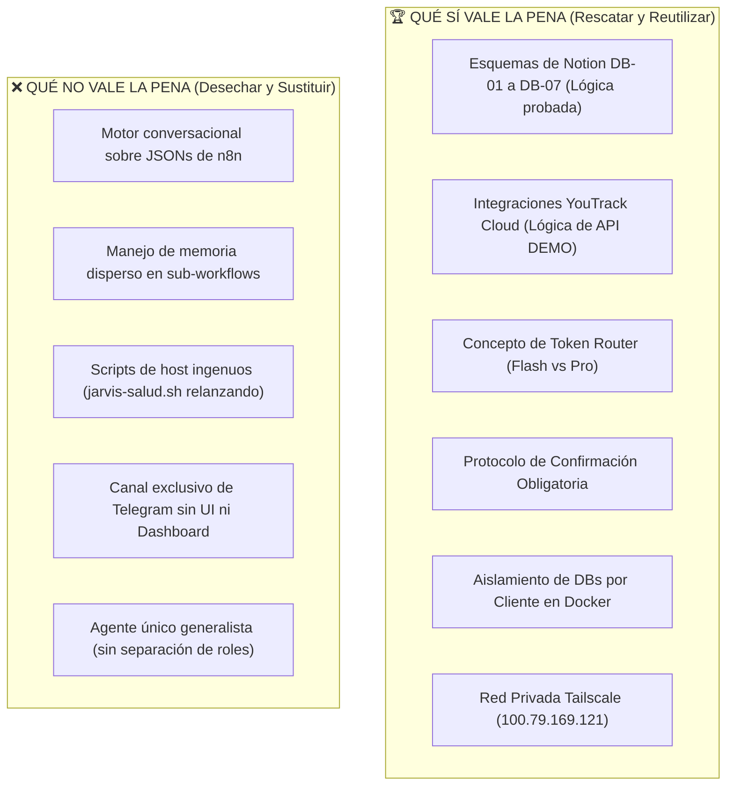

# 🔍 Análisis Crítico y Auditoría: De Jarvis v1.0 a Proyecto Jericó
### Evaluación Exhaustiva de lo Construido, Veredicto de Viabilidad y Rescate de Activos

---

## 1. Radiografía de lo Construido: El Ecosistema Jarvis v1.0

Durante la primera etapa de automatización de Kaisen AI, se construyó el asistente **Jarvis**. Este sistema no era un producto de software unificado, sino una constelación de flujos de trabajo, scripts y contenedores distribuidos entre el servidor de producción (`100.79.169.121`) y la máquina local de Santiago.

### A. Inventario de Flujos de n8n (25 Workflows)
* **Canal Conversacional Central:**
  * `Jarvis-Conversacion.bak-final-1707.json` (Flujo monolítico principal de Telegram).
  * `Jarvis-Conversacion.bak-tier1-1937.json` (Router dinámico para balanceo entre Gemini Flash y Pro).
  * `Jarvis-Conversacion.bak-redsiri-1946.json` (Integración de Siri con Redis para memoria volátil).
  * `Jarvis-Conversacion.bak-ytadmin-20260807-1740.json` (Integración con API de YouTrack).
  * `Jarvis-Conversacion.bak-infra-1725.json` (Comandos de infraestructura y salud del host).
* **Workflows Programados (Schedules):**
  * `jarvisFase1Brief` (Briefing matutino 7:00 AM).
  * Contexto Empresa (6:00 AM).
  * `Jarvis-FinAudit` (Auditor financiero nocturno 9:00 PM contra Notion DB-07).
  * `Jarvis-PlanNoche` (Planificador nocturno 8:30 PM para Modo Cueva DB-02).
  * Recordatorios periódicos cada 30 min (con deduplicación en Redis).
* **Workflows Auxiliares y Agentes de Código:**
  * `Jarvis-Opus` (Nivel 5: Forjar y ejecutar scripts autónomos en el servidor).
  * `Jarvis-GHWrite` (Escritura y creación de ramas en GitHub).
  * Jules Code Agents (Auditor cada 2h, Organizador 8pm, Vigía y RPC).
  * `jarvisErrorNotf1` (Manejador central de fallos y alertas a Telegram).

### B. Paquete de Herramientas Operativas (`jarvis-ops` - 38 Tools)
Jarvis consolidó la especificación de 38 herramientas que le permitían interactuar con:
1. **Notion ("Segundo Cerebro"):**
   * `DB-01 SANCTUM` (Devocional matutino).
   * `DB-02 MODO CUEVA` (Seguimiento de hábitos, métricas físicas, integridad).
   * `DB-03 SOMPAN` (Mapeo de proyectos estratégicos).
   * `DB-04 KAISEN/SKYNET` (Clientes, entregables y estados).
   * `DB-05 INCUBADORA` (Ideas de producto).
   * `DB-07 FINANZAS` (Auditoría diaria de ingresos, gastos y deudas en COP).
2. **YouTrack Cloud (`https://kaisensky.youtrack.cloud`):**
   * Consulta, creación, actualización y asignación de tickets (Proyecto `DEMO` y futuros).
3. **Servicios de Google:**
   * Google Calendar (lectura y escritura de eventos) y Gmail.
4. **Infraestructura y DevOps:**
   * Ejecución de comandos SSH controlados en `desktop-8f1b898`.
   * Pings de contenedores y lectura de logs.

### C. Infraestructura Física y Docker en Producción
* **Servidor Central (`desktop-8f1b898` - `100.79.169.121`):**
  * WSL2 corriendo Ubuntu 26.04 sobre hardware de escritorio (Intel i5-12450H, 23 GB RAM, 1 TB disco).
  * GPU: NVIDIA RTX 3050 Laptop (4 GB) sin toolkit de contenedores activo.
* **Contenedores Docker Activos:**
  * `skynet-n8n-1` y `skynet-n8n-worker-1` (Motor de flujos).
  * `skynet-postgres-1` y `skynet-redis-1` (Persistencia interna de n8n y cola).
  * `skynet-cloudflared-1` (Túnel Zero Trust hacia `n8n.getkaisen.com`).
  * `jarvis-renderer` (Renderizado de diagramas).
  * Bases de datos aisladas de clientes: `segurosbolivar-db`, `mundodeoro-db`.
* **Scripts en el Host (`/home/kaisenai/`):**
  * `jarvis-salud.sh` (Vigía en cron cada 5 min).
  * `jarvis-metrics.py` (Métricas de sistema, actualmente pausado).
  * `jarvis-auto-deploy.sh` (Despliegue automático de ramas, pausado).

---

## 2. Diagnóstico Técnico: ¿Por qué colapsó Jarvis y fue pausado el 16/08/2026?

A pesar de su éxito funcional inicial, el modelo arquitectónico de Jarvis llegó a un límite estructural insalvable:

1. **El "Monolito de Nodos" en n8n:**
   * Los flujos de n8n son grafos JSON declarativos diseñados para integración de datos lineal o ETL, no para arquitecturas de agentes autónomos con bucles de razonamiento, memoria dinámica y manejo fino de excepciones.
   * Modificar un nodo implicaba el riesgo de romper 15 caminos alternativos del flujo.
2. **Imposibilidad de Pruebas Unitarias y CI/CD Real:**
   * No se podían correr tests automatizados con `pytest` ni validar tipados antes de poner en producción.
   * Los cambios se probaban en caliente ("in vivo"), generando inestabilidad.
3. **Latencia Excesiva y Sobrecarga de Saltos HTTP:**
   * Cada turno conversacional requería pasar por webhooks de Telegram, n8n router, llamadas a Redis, peticiones al LLM y llamadas a APIs de Notion/YouTrack, generando tiempos de respuesta de 4 a 8 segundos por mensaje.
4. **Vulnerabilidad a Cambios de Modelos Externos:**
   * Flujos como `TaxisMVP` quedaron inutilizados cuando Google deprecó modelos en alias preview (`gemini-3-flash-preview`), dejando la base de datos inaccesible por falta de desacoplamiento.
5. **Watchdogs con Lógica Defectuosa ("Cry Wolf"):**
   * El script `jarvis-salud.sh` interpretaba la respuesta `302 Found` de Cloudflare Zero Trust como un error y reiniciaba innecesariamente el contenedor `cloudflared` 288 veces al día (1.495 relanzamientos acumulados).

---

## 3. El Veredicto Objetivo: ¿Qué SÍ Vale la Pena y qué NO?

### ✅ QUÉ SÍ VALE LA PENA (Activos de Alto Valor):
1. **El Catálogo Funcional de Herramientas (Tool Specs):**
   * Los endpoints, payloads y lógica de negocio para interactuar con YouTrack, Google Calendar, Notion, GitHub y Docker ya están mapeados y validados. No hay que inventar qué hace cada herramienta; solo portarlas a clases Python tipadas (`Pydantic`).
2. **Los Esquemas de Datos de Notion y PostgreSQL:**
   * Las estructuras de `DB-01 Sanctum`, `DB-02 Modo Cueva` y `DB-07 Finanzas` son de inmenso valor personal y estratégico para Santiago. Su diseño se mantiene intacto.
3. **El Principio del Token Router:**
   * La idea de clasificar la intención con un modelo ultrarrápido y barato (Gemini Flash) antes de invocar modelos pesados y costosos (Gemini Pro / Claude) demostró ahorrar hasta un 70% de tokens y latencia.
4. **El Protocolo de Confirmación de Escritura:**
   * La regla de que ningún agente modifica YouTrack, Calendar o bases de datos sin autorización previa del usuario es un guardrail vital que debe ser el estándar de Jericó.
5. **La Topología de Infraestructura Segura:**
   * La red Tailscale (`kaisen.ai`), el acceso por SSH con llaves `ed25519` y el aislamiento de un contenedor de base de datos por cliente (`segurosbolivar-db`, `mundodeoro-db`) son arquitecturas sólidas que se mantienen.

### ❌ QUÉ NO VALE LA PENA (Debe Desecharse / Reemplazarse):
1. **n8n como Núcleo de Inteligencia Artificial:**
   * n8n debe regresar a su función natural: webhooks sencillos de terceros y automatizaciones de bajo nivel. **Nunca más debe ser el cerebro ni el orquestador conversacional**.
2. **Los Scripts Frágiles en Crontab:**
   * Los scripts en Bash (`jarvis-salud.sh`) deben ser sustituidos por un demonio de monitoreo moderno en Python (con FastAPI / Prometheus health checks) que entienda códigos de respuesta HTTP y estados de Docker reales.
3. **El Paradigma de Monocanal (Solo Telegram):**
   * Depender de un chat de Telegram limita la capacidad de Kaisen AI. Se requiere una interfaz visual con streaming de voz real para interacción constante.
4. **La Falta de Diferenciación de Agentes:**
   * Intentar que un solo prompt gigante maneje finanzas, devocional, dev, marketing y atención de clientes genera alucinaciones y context overflow. Jericó debe nacer como una constelación de agentes especializados.

## 4. Revalorización v2 — Duo barato + voz propia (20/09/2026 16:00)
* **Descartado:** Gemini Pro + Claude Opus/Sonnet (50-100x costo, sin clonación voz).
* **Adoptado:** `GLM-5.3-Flash` (~$0.075/$0.25, 1M ctx, MoE 320B/18B, tools+reasoning, MIT) para router/comercial/estratega; `DeepSeek-V4.1-Flash` (`deepseek-flash`, thinking+FIM) para código; `Gemini AI Studio` solo bootstrap. Ambos OpenAI-compatibles, pin de versión.
* **Voz:** fuera Live API. STT `faster-whisper` + TTS `Fish S1-mini` (v0 CPU) → `Fish S2 / XTTS v2` (v1). Voces en `voices/` fuera del repo, consentimiento + kill-switch.
* **Estado:** `EL_COMO` + `ORGANIZACION` + `ARQUITECTURA` en v2. Infra v0 Oracle limpio; `.121` en quarantine.

---
> 🕒 **Última modificación:** 20/09/2026 16:00 (Agente Antigravity)
