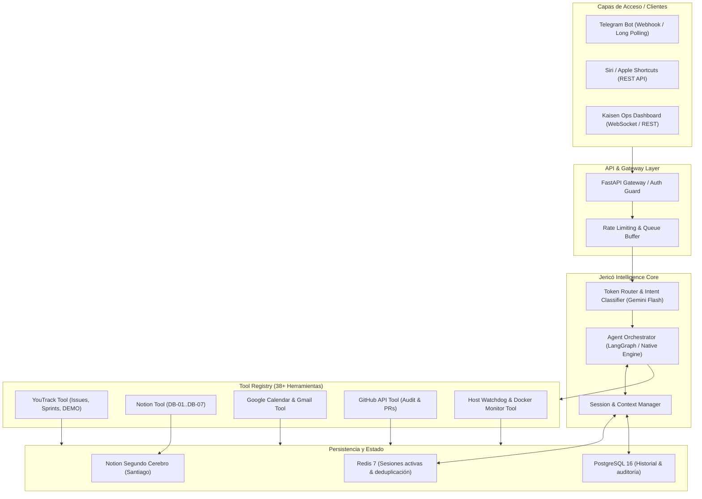

> ⚠️ **REGLA VIGENTE v2 (muse-instructions):** Prohibido en v0: LangChain/LangGraph, Celery, Next.js, Tauri, Gemini Live API. Modelos pinedos: `glm-5.3-flash` (L1) + `deepseek-flash` (L2); prohibido `-latest`/`-preview` (lección TaxisMVP). Infra v0: Oracle Free Tier limpio; `100.79.169.121` en quarantine. Las menciones v1 del cuerpo (LangGraph, Celery, Gemini Live API, Next.js, orquestación con Gemini) quedan **DEPRECADAS** y solo valen como historia del boceto.

# 🏛️ Arquitectura de Proyecto Jericó

## 1. Contexto y Justificación
**Proyecto Jericó** nace como la evolución directa del asistente operativo **Jarvis** de Kaisen AI.
Jarvis operó mediante una constelación de 25 flujos de trabajo en n8n conectados a un bot de Telegram, webhooks y scripts en el host WSL2 del servidor de producción.

Si bien esta implementación inicial resolvió necesidades críticas operativas y de seguimiento personal (Modo Cueva, Sanctum, finanzas, recordatorios y YouTrack), reveló limitaciones estructurales:
- **Fragilidad en despliegues y control de versiones:** Los JSON de n8n son difíciles de testear de forma unitaria y versionar de forma granular en Git.
- **Acoplamiento al runtime de n8n:** La memoria de sesión, el manejo de reintentos y el contexto entre turnos requerían parches y nodos auxiliares (como `jarvisRecordar01` con Redis y sub-workflows).
- **Latencia y observabilidad:** El flujo conversacional con ruteo de herramientas agregaba saltos innecesarios entre webhooks y nodos de transformación.

**Jericó** sustituye esta infraestructura mediante una arquitectura modular, extensible y orientada a servicios, desacoplada de n8n y con control nativo de modelos de lenguaje, herramientas y persistencia.

---

## 2. Diagrama de Arquitectura

---

## 3. Capas Principales del Sistema

### 3.1. Gateway y Ruteo Omnicanal
* **Telegram:** Recepción de mensajes de texto y notas de voz. Las notas de voz son transcritas mediante Whisper / Gemini Multimodal antes de ingresar a la cola del orquestador.
* **Siri / Atajos de Apple:** Endpoint `/api/v1/siri` optimizado para respuestas concisas (2-4 oraciones, sin markdown complejo ni emojis innecesarios).
* **Autenticación e Identidad:** Whitelist estricto de usuarios (Telegram ID `2099727924` para Santiago). Respuestas de error silenciosas o de rechazo para usuarios no autorizados.

### 3.2. Ruteo Inteligente de Modelos (Token Router) — v2 20/09/2026 16:00
Hereda el patrón de Jarvis pero con duo barato OpenAI-compatible:
* **Nivel 0 (Rápido / Conversacional):** Saludos, acuse ➔ directo sin tools.
* **Nivel 1 (Operativo Rutinario):** YouTrack, agenda, devocional ➔ **GLM-5.3-Flash** (`glm-5.3-flash`, ~$0.075/$0.25, 1M ctx).
* **Nivel 2 (Código / Finanzas / Arquitectura):** Auditoría, PRs, decisiones ➔ **DeepSeek-V4.1-Flash** (`deepseek-flash`, thinking+FIM).
* **Bootstrap:** Gemini AI Studio solo creación inicial, no prod. Prohibidos aliases `-latest/preview` en prod (lección TaxisMVP).

### 3.3. Registro de Herramientas (Tool Registry)
Las 38 herramientas de `jarvis-ops` se encapsulan en clases Python tipadas con Pydantic, garantizando:
* Validación estricta de argumentos antes de la invocación.
* Confirmación explícita para operaciones de escritura crítica (Protocolo Santiago: *anunciar acción ➔ esperar aprobación ➔ ejecutar*).
* Manejo automático de backoff exponencial y reintentos ante fallos temporales de red.

### 3.4. Memoria y Estado
* **Memoria de Corto Plazo:** Redis 7 para estado conversacional activo (ventana deslizante de últimos mensajes).
* **Memoria de Largo Plazo:** PostgreSQL para bitácora persistente de interacciones, decisiones y eventos.
* **Deduplicación:** Llaves Redis tipo `jerico:recordados:<id_evento>` con TTL de 24 horas para evitar repetición de recordatorios y alertas.

---

## 4. Hoja de Ruta de Desarrollo

1. **Sprint 1: Esqueleto del Servicio y Gateway (Python/FastAPI)**
   - Configuración de entorno, tipado, tests unitarios con `pytest`.
   - Webhook de Telegram y endpoint Siri con autenticación.
2. **Sprint 2: Adaptadores de Integración (Tools Core)**
   - Adaptador Notion (DB-01 Sanctum, DB-02 Modo Cueva, DB-07 Finanzas).
   - Adaptador YouTrack Cloud (`https://kaisensky.youtrack.cloud`).
   - Adaptador Google Calendar (eventos y recordatorios).
3. **Sprint 3: Orquestador y Memoria Unificada**
   - Agente con router semántico y soporte de memoria compartida Telegram ↔ Siri.
4. **Sprint 4: Despliegue en Servidor de Producción**
    - Dockerfile multi-stage, compose service `jerico-core`.
    - Reemplazo definitivo y desmantelamiento de los flujos de n8n de Jarvis.
5. **Sprint 0 previo (Oracle Free Tier):** VPS limpio + Tailscale + PG/Redis nuevos. `100.79.169.121` en quarantine.

### 3.5. Voz propia (anexo v2 20/09/2026 16:00)
STT `faster-whisper` + TTS clonado `Fish S1-mini` (v0 CPU) → `Fish S2 / XTTS v2` (v1). Voces en `voices/` fuera del repo, con consentimiento.

---
> 🕒 **Última modificación:** 20/09/2026 16:00 (Agente Antigravity)
