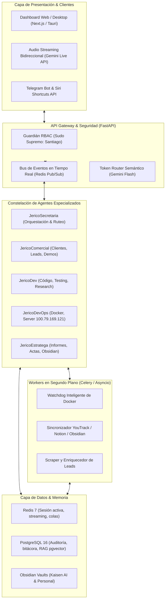
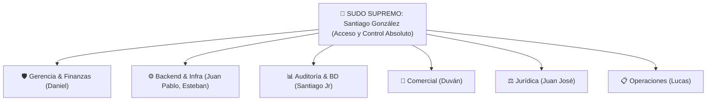

> ⚠️ **REGLA VIGENTE v2 (muse-instructions):** Prohibido en v0: LangChain/LangGraph, Celery, Next.js, Tauri, Gemini Live API. Modelos pinedos: `glm-5.3-flash` (L1) + `deepseek-flash` (L2); prohibido `-latest`/`-preview` (lección TaxisMVP). Infra v0: Oracle Free Tier limpio; `100.79.169.121` en quarantine. Las menciones v1 del cuerpo (LangGraph, Celery, Gemini Live API, Next.js, orquestación con Gemini) quedan **DEPRECADAS** y solo valen como historia del boceto.

---
tipo: especificacion-arquitectura-ejecucion
proyecto: Proyecto Jerico
autor: Santiago Gonzalez (CTO Kaisen AI)
creado: "20/09/2026 15:25"
modificado: "20/09/2026 16:00"
estado: diseno de ingenieria
revision: v2-stack-economico-GLM-DeepSeek-VozPropia
tags:
  - jerico
  - stack
  - arquitectura
  - roadmap
  - fastapi
  - docker
---

# 🚀 El "Cómo": Arquitectura Técnica, Stack y Plan de Ejecución — Jericó
### Especificación Técnica de Ingeniería para el Asistente y AI-OS de Kaisen AI

---

## 🏗️ 1. Arquitectura General del Sistema

Jericó abandona los grafos monolíticos en n8n y adopta una arquitectura desacoplada basada en micro-servicios, eventos asíncronos y agentes especializados coordinados por un núcleo central de inteligencia.

---

## 💻 2. Stack Tecnológico Seleccionado — v2 Económico (rev. 20/09/2026 16:00)

> Decisión CTO: fuera Gemini Pro / Claude Opus por costo. Se adopta duo barato + voz propia clonada.

| Componente | Tecnología v2 | Justificación Técnica + Costo |
| :--- | :--- | :--- |
| **Backend Core** | Python 3.12 + FastAPI + Asyncio | Sin cambio. Core en Oracle Free Tier (Ampere A1, Docker). |
| **Modelos barato v2** | `GLM-5.3-Flash` (z-ai, `glm-5.3-flash`) para ruteo/comercial/estratega + `DeepSeek-V4.1-Flash` (`deepseek-flash`) para código/razonamiento | GLM ~$0.075 in / $0.25 out x 1M, 1M ctx, MoE 320B/18B, tools + reasoning, OpenAI-compatible, pesos MIT. DeepSeek ~$0.09-0.15 in / $0.18-0.66 out, 1M ctx, thinking mode + FIM + tool-calls. 50-100x más barato que Opus/Pro. Ambos OpenAI-SDK, mismo `BaseURL` conmutable. |
| **Bootstrap / Creación** | Gemini AI Studio (free tier) solo para prototipado y generación de datasets/prompts iniciales | No es ruta prod. Sirve para crear specs, fixtures y validar antes de quemar saldo Zhipu/DeepSeek. |
| **Voz propia (sin Live API)** | STT: `faster-whisper` CPU local + TTS clonación: `Fish Speech S1-mini 0.5B` (self-host CPU v0) → `Fish S2 Pro / XTTS v2` (GPU/calidad v1) | Clonar voz Santiago / miembro con sample 10-30s, consentimiento explícito. Cero `Gemini Live API` en v0 (costo/min + sin clonación). Flujo v0: push-to-talk half-duplex 1-2s, no streaming <500ms. Servidor `jerico-voice` aparte del `jerico-core` porque Oracle A1 no tiene GPU. |
| **Frontend / Dashboard** | Next.js 15 diferido a Fase 3; v0 CLI + Telegram + `GET /healthz` + HTMX mínimo | Sin cambio de visión full, pero no bloquea core. |
| **Colas y Fondo** | Asyncio + APScheduler v0 (interfaz `Queue` lista para Celery en v1) | Sin operar Celery solo en Oracle free. |
| **Bases de Datos** | PostgreSQL 16 + Redis 7 en Oracle (nuevos, no `skynet-*` de WSL2) | Fuente de verdad PG; Notion solo vista. |
| **Infraestructura** | Oracle Cloud Free Tier (nuevo VPS limpio) + Tailscale + Docker Compose | `100.79.169.121` congelado en quarantine hasta Fase 5. |

---

### 3. Voz propia clonada (sustituye Gemini Live en v0)
* **Fase v0:** Telegram voice-note → `faster-whisper` → GLM/DeepSeek → `Fish S1-mini` con voz clonada Santiago → audio Telegram. Consentimiento + `voices/` fuera del repo.
* **Fase v1:** `jerico-voice` FastAPI (`POST /v1/stt`, `POST /v1/tts`) con XTTS v2 / Fish S2, GPU externa o API Fish.audio cuando Oracle CPU no alcance.
* **Regla:** ninguna voz de miembro se usa sin autorización escrita + kill-switch por voz.

## 👥 3. Constelación de Micro-Agentes Especializados

Para evitar sobrecargar un solo agente, Jericó opera con agentes desacoplados con contextos delimitados:

### 1. `JericoSecretaria` (Cerebro Central y Ruteador)
* **Modelos:** `GLM-5.3-Flash` por defecto (ruteo + comercial + actas). `DeepSeek-V4.1-Flash` con `thinking` para código/arquitectura/finanzas complejas. Gemini AI Studio solo bootstrap.
* **Flujo Transversal en Tiempo Real:** Cuando `JericoComercial` interactúa con un cliente, `JericoSecretaria` genera automáticamente un evento que:
  * Envía un resumen ejecutivo a Santiago (CTO).
  * Notifica al área técnica en YouTrack si hay requerimientos de arquitectura.
  * Informa al área administrativa si hay presupuestos o cotizaciones involucradas.

### 2. `JericoComercial` (Frontline y Factoría de Demos)
* **Atención al Cliente:** Chatbot empático y profesional conectado al sitio web o canales de prospección.
* **Calificación de Leads:** Mapeo de presupuesto, tiempos y necesidades técnicas.
* **Generación de Demos:** Capacidad de ensamblar demos parametrizadas (por ejemplo, instancias de prueba de un ERP para joyería o cotizadores de seguros).

### 3. `JericoDev` (Asistente de Ingeniería de Software)
* **Desarrollo de Código:** Creación de componentes React, endpoints FastAPI, modelos de datos Prisma/SQLAlchemy y migraciones.
* **Investigación Profunda:** Navegación en documentación oficial (vía MCP o APIs), resolución de errores de build y sugerencias de arquitectura limpia.
* **Inventario de Servicios:** Conoce todos los repositorios de la empresa en GitHub (`kaisen-ai-skynet`).

### 4. `JericoDevOps` (SysAdmin y Salud de Servidores)
* **Interacción Directa con Docker:** Conectado al socket de Docker en `desktop-8f1b898`.
* **Supervisión Continua:** Conoce el estado de salud de `skynet-n8n-1`, `cliente-a-db`, `cliente-b-db` y `cliente-a-ai-gateway`.
* **Watchdog Inteligente:** No reinicia contenedores por códigos HTTP temporales (corrige el error de `jarvis-salud.sh`).
* **Migraciones Asistidas:** Ejecuta scripts de backup y despliegues con capacidad de rollback inmediato.

### 5. `JericoEstratega` (Documentación y Bases de Conocimiento)
* **Redacción Institucional:** Creación de actas técnicas, propuestas formales en Markdown/PDF y contratos preliminares.
* **Sincronización Viva:** Lee y escribe en las bóvedas de Obsidian (`~/Kaisen_AI/02_Obsidian_Kaisen/`) y actualiza tickets en YouTrack (`https://kaisensky.youtrack.cloud`).

---

## 🛡️ 4. Matriz de Seguridad y Roles (RBAC)

El sistema de seguridad de Jericó implementa una jerarquía estricta basada en roles:

### Privilegios del "Sudo Supremo" (Santiago González):
1. **Canal Seguro Exclusivo:** Reconocimiento biométrico/dispositivo de su estación local (`janty` / `100.89.111.64`) y Telegram ID verificado.
2. **Override Total:** Capacidad de autorizar o abortar cualquier proceso en ejecución.
3. **Escritura No Restringida:** Puede autorizar mutaciones masivas o saltarse la confirmación paso a paso si lo instruye explícitamente.
4. **Acceso Confidencial:** Visualización de métricas financieras de Notion (`DB-07 Finanzas`), contraseñas en memoria e inventario de secretos.

### Protocolo de Confirmación Obligatoria (Para los demás roles):
* Antes de ejecutar mutaciones en YouTrack, bases de datos de clientes o despliegues en Docker, Jericó presenta el resumen:
  `[ACCIÓN PROPUESTA] ➔ [IMPACTO] ➔ [SOLICITUD DE CONFIRMACIÓN (Sí/No)]`.

---

## 📈 5. Plan de Ejecución por Fases (Hoja de Ruta)

### Fase 1: Esqueleto del Núcleo y API Gateway (Semana 1)
- [x] Consolidación de bocetos, especificaciones e inventario de rutas.
- [ ] Estructura base en Python 3.12 con FastAPI en `~/Kaisen_AI/01_Proyectos/Proyecto_Jerico`.
- [ ] Implementación de `TokenRouter` con Gemini 2.5 Flash y autenticación RBAC.
- [ ] Pruebas unitarias de endpoints con `pytest`.

### Fase 2: Portabilidad del Catálogo de Herramientas (Semana 2)
- [ ] Adaptador Python para YouTrack Cloud (`https://kaisensky.youtrack.cloud`).
- [ ] Adaptador Python para Notion API (`DB-01 Sanctum`, `DB-02 Modo Cueva`, `DB-07 Finanzas`).
- [ ] Adaptador Python para Google Calendar y Gmail.
- [ ] Adaptador de monitoreo Docker (Docker SDK para Python).

### Fase 3: Voz Continua y Dashboard Visual (Semana 3)
- [ ] Integración de streaming de voz bidireccional con Gemini Live API.
- [ ] Construcción del Dashboard visual interactivo en Next.js con conexión WebSockets.
- [ ] Invocación por atajo y presencia en segundo plano (daemon).

### Fase 4: Micro-Agentes y Flujo Transversal Comercial (Semana 4)
- [ ] Despliegue de `JericoComercial` con webhook de captación de leads.
- [ ] Bus de eventos para alertas cruzadas (Comercial ➔ Admin ➔ Técnica ➔ Santiago).
- [ ] Activación de `JericoDev` con capacidades de análisis de repositorios locales.

### Fase 5: Despliegue en Producción y Retiro de Jarvis (Semana 5)
- [ ] Creación de `docker-compose.yml` para `jerico-core` en `100.79.169.121`.
- [ ] Verificación de red interna `skynet_skynet_net` y enlace con PostgreSQL y Redis.
- [ ] Desmantelamiento definitivo de los 25 flujos de n8n de Jarvis.

### Fase 0: VPS Oracle Free Tier (previo a todo)
- [ ] Provisionar Ampere A1 + Tailscale + Docker + PG/Redis nuevos para Jericó.

---
> 🕒 **Última modificación:** 20/09/2026 16:00 (Agente Antigravity)
