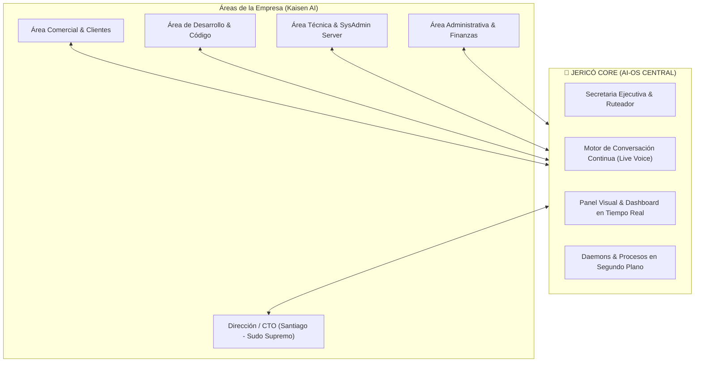

# 🧠 Organización Sistémica de Ideas y Visión — Proyecto Jericó
### El Sistema Operativo y Secretaria Ejecutiva Inteligente de Kaisen AI

---

## 🧭 1. Manifiesto y Propósito Fundamental

**Jericó** no es simplemente un chatbot ni un bot de mensajería; es concebido como el **Sistema Operativo Inteligente (AI-OS) y la Secretaria Ejecutiva Central de Kaisen AI**. Su objetivo es ser la entidad inteligente omnipresente, proactiva y transversal que cohesione las áreas comerciales, técnicas, administrativas y de dirección estratégica de la empresa, actuando tanto en primer plano (interfaz visual y voz fluida) como en segundo plano (automatización y monitoreo autónomo).

Santiago González, como **CTO y Sudo Supremo**, delega en Jericó la carga cognitiva operativa, garantizando un flujo de información en tiempo real, protección de márgenes, ejecución de código y blindaje de la infraestructura.

---

## 🏛️ 2. Mapeo Estructurado de Pensamientos y Deseos (Los 9 Pilares)

A continuación se organizan y clasifican todos los deseos, requerimientos y ambiciones expresados por Santiago para Jericó:

### Pilar I: Secretaría Comercial y Atención al Cliente en Tiempo Real
* **Frontline Comercial Autónomo:** Jericó interactúa de forma inmediata y personalizada con los clientes y prospectos (vía web, WhatsApp o Telegram) en el momento en que llegan.
* **Co-pilotaje Comercial:** No reemplaza al asesor comercial humano; lo asiste. Registra cada consulta, objeción, requerimiento técnico y expectativa del cliente.
* **Ruteo y Alertas en Tiempo Real (Puente Transversal):**
  * Toda la información recolectada se procesa al instante.
  * Emite alertas y minutas inmediatas a:
    1. **Área Comercial:** Estado del lead, perfil de necesidad, temperatura de compra.
    2. **Área Administrativa / Finanzas:** Presupuestos estimados, cotizaciones y viabilidad.
    3. **Área Técnica:** Requerimientos de arquitectura, complejidad y dependencias.
    4. **CTO (Santiago):** Resumen ejecutivo en tiempo real en su canal prioritario.

### Pilar II: Interfaz Visual Interactiva y Operación Silenciosa en Segundo Plano
* **Interfaz Visual Propia (Dashboard / UI):**
  * Un panel interactivo moderno (Web y App de Escritorio) donde se visualiza la actividad del sistema: estado de leads, métricas de infraestructura, colas de tareas activas y logs de decisiones.
* **Procesamiento Asíncrono en Segundo Plano (Background Daemons):**
  * Jericó vive y trabaja 24/7 sin requerir una conversación abierta.
  * Ejecuta tareas pesadas en segundo plano: sincronización de bases de datos, generación de reportes, scraping de investigación, compilación de datos y auditorías programadas.

### Pilar III: Conversación Fluida, Omnipresente y Constante por Voz — v2 Voz propia clonada (rev. 20/09/2026 16:00)
* **Decisión CTO: fuera Gemini Live API por costo. Voz propia clonada.**
* **Pipeline v0 (half-duplex, no streaming):** Push-to-talk / voice-note Telegram → `faster-whisper` STT local → GLM/DeepSeek → TTS `Fish S1-mini` con timbre Santiago/miembro (sample 10-30s, consentimiento).
* **Pipeline v1:** servicio `jerico-voice` (`XTTS v2` / `Fish S2 Pro`, español Tier-2 verificado) en GPU externa o API cuando Oracle A1-CPU no alcance.
* **Invocación ("Hey Jericó"):** diferida a v2; v0 solo botón/atajo + Telegram.
* **Reconocimiento de Identidad:** se mantiene por ID + voz inscrita en `voices/` (fuera del repo).

### Pilar IV: Asistente de Ingeniería de Software (Dev & Code Agent)
* **Generación y Asistencia de Código:**
  * Cuando un desarrollador solicita código, Jericó genera componentes, endpoints, scripts de migración, tests o refactorizaciones siguiendo los estándares de Kaisen AI.
* **Investigación Técnica y Benchmark:**
  * Investiga librerías, APIs de terceros, cambios en SDKs y documentación técnica sin saturar el flujo de trabajo del desarrollador.
* **Indagación de Servicios Existentes y Futuros:**
  * Jericó tiene indexado todo el catálogo de servicios de la empresa (ERP para joyería, automatización para un corredor de seguros, MVP de movilidad, facturación electrónica, automatizaciones n8n) y puede contrastar requerimientos nuevos contra lo ya existente.

### Pilar V: Marketing, Prospección y Factoría de Demos
* **Campañas de Marketing y Contenidos:**
  * Apoyo en la estrategia de atracción, creación de copys comerciales, embudos de venta y posts técnicos.
* **Captación y Calificación de Leads:**
  * Prospección de empresas en nichos objetivo (PYMES industriales, corretaje de seguros, cooperativas de transporte).
* **Factoría Rápida de Demos Interactivas:**
  * Capacidad de ensamblar demos funcionales y parametrizadas para clientes potenciales en cuestión de horas, mostrando el valor tangible de Kaisen AI antes del cierre contractual.

### Pilar VI: SysAdmin, DevOps y Arquitectura de Infraestructura
* **Control del Servidor Central (`100.79.169.121`):**
  * Monitoreo proactivo de contenedores Docker (`skynet-n8n-1`, `skynet-postgres-1`, `cliente-a-db`, `cliente-b-db`, `cliente-a-ai-gateway`).
  * Watchdogs inteligentes con auto-remediación (reiniciar contenedores caídos, limpiar logs, liberar espacio).
* **Organización de Bases de Datos:**
  * Mantenimiento de integridad, respaldo de esquemas y verificación de cuotas en PostgreSQL, Supabase y Notion.
* **Preparación de Migraciones:**
  * Asistencia activa en la migración de servidores, actualización de kernels, transición de WSL2 a Linux nativo y despliegue continuo de código.

### Pilar VII: Redacción de Documentos, Actas y Apoyo Estratégico
* **Redactor Formal Institucional:**
  * Generación de informes técnicos de entrega, contratos preliminares, propuestas comerciales y actas de reuniones.
* **Estratega y Asesor de Decisiones:**
  * Análisis de rentabilidad, proyección de costos en infraestructura y evaluación de riesgos técnicos.
* **Custodio de la Base de Conocimiento:**
  * Mantener sincronizadas y actualizadas las bóvedas de Obsidian (`~/Kaisen_AI/02_Obsidian_Kaisen/`) y los tableros de YouTrack (`https://kaisensky.youtrack.cloud`).

### Pilar VIII: Jerarquía de Seguridad y Roles (RBAC — "Sudo Supremo")
* **Santiago González = SUDO SUPREMO:**
  * Máxima autoridad del sistema. Control absoluto desde su estación de trabajo (`janty`).
  * Facultades exclusivas: bypass de confirmaciones, alteración de roles, autorización de despliegues críticos a producción, acceso a métricas financieras confidenciales y comando de apagado de emergencia.
* **Control de Acceso Basado en Roles (RBAC):**
  * Niveles de privilegio para cada miembro:
    * *CTO (Santiago):* Acceso total irrestricto.
    * *Gerencia (Daniel):* Métricas comerciales, operativas y visión global.
    * *Backend / Infra (Juan Pablo, Esteban):* Entornos de código, Docker y logs técnicos.
    * *Auditoría / BD (Santiago Jr):* Acceso de lectura y auditoría sobre esquemas y datos.
    * *Comercial (Duván):* Pipeline de ventas, prospectos y demos.
    * *Jurídica (Juan José):* Documentos legales, actas y cumplimiento normativo.
    * *Operaciones (Lucas):* Mapeo de procesos y entregables de campo.

### Pilar IX: Contexto Masivo, Enrutado Inteligente y Memoria Unificada — v2 Duo barato (rev. 20/09/2026 16:00)
* **Distribución Eficiente del Contexto:**
  * Memoria de corto plazo en memoria RAM / Redis para diálogos en curso.
  * Memoria episódica y relacional en PostgreSQL para auditoría y trazabilidad histórica.
  * Memoria semántica masiva mediante RAG híbrido (búsqueda vectorial + grafos de conocimiento + Markdown en Obsidian).
* **Ruteo de Tokens v2 (Eficiencia y Costos):**
  * `GLM-5.3-Flash` (z-ai, ~$0.075/$0.25 x 1M, 1M ctx, tools+reasoning) para 80% tareas + ruteo.
  * `DeepSeek-V4.1-Flash` (`deepseek-flash`, thinking+FIM) para código/arquitectura/finanzas complejas.
  * `Gemini AI Studio` solo bootstrap/creación inicial, no prod.

---

## 🎯 3. Matriz de Síntesis: Visión Operativa de Jericó

| Dimensión | Enfoque Anterior (Jarvis) | Visión Consolidada (Jericó) |
| :--- | :--- | :--- |
| **Entidad** | Bot personal de Telegram para Santiago. | Secretaria y AI-OS de Kaisen AI para toda la empresa. |
| **Arquitectura** | 25 flujos monolíticos en n8n conectados por webhooks. | Backend modular independiente (Python/FastAPI) con agentes y workers. |
| **Interfaz** | Solo chat y audio en Telegram. | Interfaz visual rica (Dashboard Web/Desktop) + Voz continua + Telegram/Siri. |
| **Interacción con Clientes** | Pasiva / Inexistente en el core. | Activa en tiempo real: califica, informa y alerta a comercial, admin y técnica. |
| **Voz** | Notas de voz unidireccionales transcribiendo con Whisper. | Voz propia clonada (Santiago/miembro, Fish/XTTS) half-duplex v0, sin Live API por costo. |
| **Desarrollo de Código** | Dependiente de sub-workflows y scripts manuales. | Dev Agent sobre `DeepSeek-V4.1-Flash` + `GLM-5.3-Flash`, sandbox propio. |
| **SysAdmin** | Scripts sueltos en cron (`jarvis-salud.sh`). | Agente DevOps integrado con Docker socket, alertas y auto-remediación. |
| **Seguridad / Roles** | Whitelist binaria de Telegram ID. | Matriz RBAC multiusuario con Santiago como **SUDO SUPREMO**. |

---
> 🕒 **Última modificación:** 20/09/2026 16:00 (Agente Antigravity)
