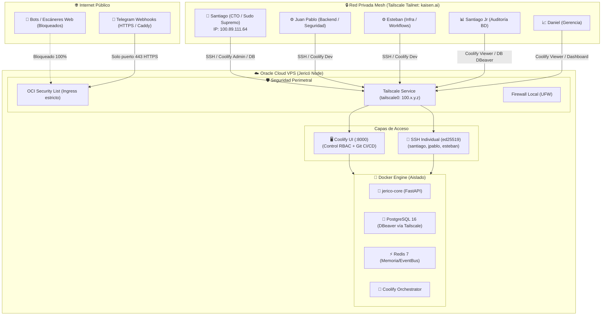
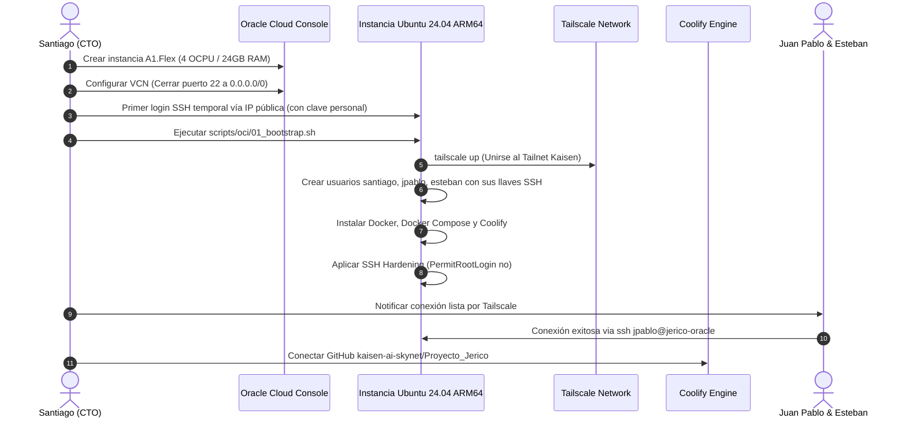
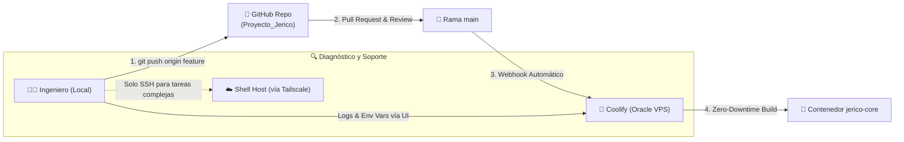

# 🛡️ Plan Maestro de Conexión y Estructuración de VPS Oracle para el Equipo
### Seguridad Zero-Trust, Accesos Individuales SSH, Tailscale Mesh y Despliegue con Coolify

> [!WARNING]
> **Revisión 11/10/2026:** Coolify (capa 4 de este plan) queda **fuera de Fase 0**: con el Always Free reducido a 2 OCPU / 12 GB y la API en el puerto 8000 se usa Docker Compose. Las capas de red, Tailscale, usuarios individuales y la prohibición de exponer 5432/6379/8000 siguen vigentes. Procedimiento operativo actual: `docs/guia-oci-principiantes.md` y `scripts/oci/`.
**Proyecto:** Jericó AI-OS — Kaisen AI  
**Repositorio Oficial:** `https://github.com/kaisen-ai-skynet/Proyecto_Jerico.git`  
**Entorno:** Oracle Cloud Infrastructure (OCI Free Tier - VM.Standard.A1.Flex ARM64 / Ubuntu 24.04 LTS)  
**Autor:** Santiago González (CTO / Sudo Supremo) & Antigravity  
**Fecha:** 20/09/2026  

---

## 🧭 1. Resumen Ejecutivo y Diagnóstico

### El Problema del Enfoque Legado (Jarvis / Host Anterior `100.79.169.121`)
En el servidor histórico de Jarvis (`desktop-8f1b898`), el acceso SSH se centralizó en una única credencial compartida (`kaisenai` / root). Esto genera graves vulnerabilidades y fallos operativos:
1. **Cero Auditoría:** Si un contenedor se cae, un archivo `.env` se altera o se ejecuta un comando destructivo, es imposible determinar qué ingeniero fue el responsable (`auth.log` solo muestra la cuenta genérica).
2. **Riesgo de Claves Filtradas:** Si un desarrollador cambia de equipo, pierde su laptop o sale de la organización, hay que cambiar la clave maestra para todos, interrumpiendo el flujo de trabajo.
3. **Exposición Perimetral:** Exponer el puerto SSH (22) o bases de datos a internet atrae ataques continuos de fuerza bruta por bots mundiales.

### La Solución para Proyecto Jericó (Fase 0 Oracle)
Para el nuevo VPS en Oracle Cloud, la infraestructura se estructura bajo **4 capas defensivas**:
- **Capa 1: Red Privada VPN Mesh (Tailscale):** Cero puertos de administración expuestos a internet público.
- **Capa 2: SSH Individualizado con Llaves ED25519:** Un usuario Linux por cada ingeniero de backend/infraestructura, con sudo granular y grupo `docker`. Login root deshabilitado.
- **Capa 3: Aislamiento con Docker Compose:** Todos los servicios (`jerico-core`, PostgreSQL 16, Redis 7) corren en contenedores; nadie edita código en caliente en el OS base.
- **Capa 4: Panel de Control de Despliegues (Coolify):** La mayoría del equipo (incluyendo auditoría y gerencia) interactúa exclusivamente mediante la interfaz web de Coolify conectada a GitHub, sin tocar jamás una terminal SSH.



---

## 👥 2. Matriz de Acceso y Roles del Equipo Kaisen AI

Basado en el equipo consolidado en `ESPECIFICACIONES_TECNICAS.md` y `ORGANIZACION_IDEAS_Y_VISION.md`:

| Miembro | Rol en Kaisen AI | Dispositivo Tailnet | Usuario Linux | Acceso SSH | Privilegios OS | Rol Coolify | Acceso BD (Postgres 5432) | Alcance y Guardrails |
| :--- | :--- | :--- | :--- | :--- | :--- | :--- | :--- | :--- |
| **Santiago González** | Fundador / Co-Owner | `janty` (`100.89.111.64`) | `santiago` | ✅ Llave SSH | ✅ Sudo Total + Docker | **Owner** | ✅ Superuser | Control maestro, bypass de emergencia, decisiones estratégicas. |
| **Nicolás** | **CTO Kaisen AI** | `nicolas-ideapad...` (`100.115.10.76`) | `nicolas` | ✅ Llave SSH | ✅ Sudo Total + Docker | **Owner** (Mismos permisos) | ✅ Superuser | Dirección técnica, arquitectura, sysadmin, gestión completa de servidores y proyectos. |
| **Juan Pablo** | **Backend Experto** | `pavlo` (`100.110.137.43`) | `jpablo` | ✅ Llave SSH | ✅ Sudo Habilitado + Docker | **Developer (Amplio)** | ✅ DDL / DML (Sin DROP DB) | Desarrollo de backend, gestión de APIs, dependencias de SO. **Guardrail:** No puede borrar/renombrar proyecto. |
| **Santiago Jr** | **Gestión APIs & BD / Ops** | `sansegura` (`100.116.14.27`) | `santiagojr` | ✅ Llave SSH | ✅ Docker (Sin sudo) | **Developer (Amplio)** | ✅ DDL / DML (Sin DROP DB) | Gestión de APIs, tokens, integraciones y conexiones de BD. **Guardrail:** No puede borrar/renombrar proyecto. |
| **Esteban** | Infra & Workflows | *(Nodo Dev)* | `esteban` | ✅ Llave SSH | ✅ Docker (Sin sudo) | **Developer** | ✅ Lectura / Test | Monitoreo Docker, pipelines, migraciones de n8n. |
| **Daniel** | Gerencia & Extracción | *(Sin OS)* | *(Ninguno)* | ❌ No | ❌ No | **Viewer** | ❌ No | Visualizar estado de servicios y métricas en Coolify. |
| **Duván** | Comercial | *(Sin OS)* | *(Ninguno)* | ❌ No | ❌ No | ❌ No | ❌ No | Interacción vía Telegram Bot / UI Jericó. |
| **Juan José** | Jurídica | *(Sin OS)* | *(Ninguno)* | ❌ No | ❌ No | ❌ No | ❌ No | Revisión de minutas y actas generadas en Obsidian. |
| **Lucas** | Operaciones | *(Sin OS)* | *(Ninguno)* | ❌ No | ❌ No | ❌ No | ❌ No | Seguimiento en YouTrack y coordinación de campo. |

> [!IMPORTANT]
> **Modelo de Co-Liderazgo y Guardrails de Proyecto:**
> 1. **Co-Dirección Técnica (Permisos Idénticos):** **Nicolás (CTO)** y **Santiago (Fundador)** poseen exactamente los mismos privilegios supremos en el VPS (Sudo Total), en Coolify (Owners), en Tailscale (Admins) y en PostgreSQL (Superusers).
> 2. **Permisos Amplios con Blindaje (Juan Pablo y Santiago Jr):**
>    - Cuentan con permisos amplios para administrar variables de entorno, APIs, webhooks, credenciales y conexiones de base de datos.
>    - **Guardrail Antierror:** Tienen rol **Developer** en Coolify. Esto les permite crear servicios, modificar configuraciones y desplegar código, pero les **restringe terminantemente la facultad de eliminar el proyecto raíz ("Delete Project"), borrar el servidor o renombrar el proyecto**.
>    - **Guardrail en Base de Datos:** Tienen permisos completos de lectura/escritura (`SELECT`, `INSERT`, `UPDATE`, `DELETE`, `CREATE TABLE`), pero **no** son propietarios del cluster ni poseen el permiso destructivo de `DROP DATABASE`.

---

## 🌐 3. Arquitectura de Red: Oracle Cloud + Tailscale Mesh

### 3.1. Configuración de Oracle Cloud VCN (Security List)
En la consola de Oracle Cloud (`Networking` ➔ `Virtual Cloud Networks` ➔ `Default Security List`):

1. **Ingress Rules Públicas (Internet 0.0.0.0/0):**
   - **UDP 41641:** (Opcional, pero recomendado) Permite conexión P2P directa para Tailscale WireGuard con mínima latencia.
   - **TCP 80 / 443:** Solo si se exponen webhooks de Telegram directos al mundo exterior. *(Si se usa Cloudflare Tunnel o Tailscale Funnel, ni siquiera estos puertos necesitan estar abiertos en OCI)*.
   - **TCP 22 (SSH):** **ELIMINAR regla de 0.0.0.0/0.** Nunca exponer el puerto 22 a la internet pública.
   - **TCP 8000 (Coolify), TCP 5432 (Postgres), TCP 6379 (Redis):** **TOTALMENTE PROHIBIDO abrirlos a 0.0.0.0/0.**

2. **Ingress Rules Privadas (Tailscale):**
   - Todo el tráfico de gestión transita de forma cifrada a través de la interfaz virtual `tailscale0`.

### 3.2. Ventajas del Tailnet para el Equipo
- Cada ingeniero instala la app de Tailscale en su estación local (Windows, macOS o Linux) y se autentica con la cuenta corporativa de Kaisen AI.
- El VPS de Oracle recibe un nombre canónico en MagicDNS (ej. `jerico-oracle.kaisen.ts.net`) y una IP fija privada (ej. `100.x.y.z`).
- No hay que lidiar con IPs públicas dinámicas ni configurar DDNS.
- Si un miembro sale del equipo, se remueve su dispositivo desde la consola de administración de Tailscale y pierde acceso instantáneamente a todos los servicios.

---

## 🔑 4. Estrategia de Acceso al Host Linux (SSH Individual)

### 4.1. Generación de Llaves por Parte de los Ingenieros
Antes de aprovisionar el servidor, cada ingeniero (`santiago`, `jpablo`, `esteban`) debe ejecutar en su máquina local:

```bash
# Ejecutar en la laptop/PC del ingeniero:
ssh-keygen -t ed25519 -C "usuario@kaisen.ai" -f ~/.ssh/id_ed25519_kaisen
```
Esto genera dos archivos:
- Clave privada: `~/.ssh/id_ed25519_kaisen` (NUNCA se comparte).
- Clave pública: `~/.ssh/id_ed25519_kaisen.pub` (Esta es la que se entrega a Santiago para el alta).

### 4.2. Hardening del Servidor SSH (`/etc/ssh/sshd_config.d/01-kaisen-security.conf`)
Para blindar el daemon SSH:

```ini
# Configuración estricta de seguridad SSH
Port 22
PermitRootLogin no
PasswordAuthentication no
ChallengeResponseAuthentication no
PubkeyAuthentication yes
AuthorizedKeysFile .ssh/authorized_keys
MaxAuthTries 3
ClientAliveInterval 300
ClientAliveCountMax 2
X11Forwarding no

# Solo los usuarios autorizados pueden autenticar por SSH:
AllowUsers santiago jpablo esteban nicolas santiagojr ubuntu
```

### 4.3. Gestión de Permisos Sudo y Docker
- **`santiago` (CTO / Sudo Supremo) y `nicolas` (Sysadmin Lead):**
  ```bash
  usermod -aG sudo,docker santiago
  usermod -aG sudo,docker nicolas
  # Permiso total administrativo con auditoría en /var/log/auth.log
  ```
- **`jpablo` (Backend & Seguridad):**
  ```bash
  usermod -aG sudo,docker jpablo
  # Privilegios sudo para depuración profunda, paquetes del SO y servicios backend
  ```
- **`esteban` (Workflows / Pipelines) y `santiagojr` (Auditoría / BD):**
  ```bash
  usermod -aG docker esteban
  usermod -aG docker santiagojr
  # Grupo docker: pueden ejecutar docker ps, logs, restart y compose sin privilegios sudo
  ```

---

## 🚀 5. Panel de Control y Despliegue Continuo: Coolify

### 5.1. ¿Por qué Coolify para Proyecto Jericó?
Coolify actúa como un **Heroku / Vercel auto-alojado** sobre el VPS de Oracle:
1. **GitHub App Oficial:** Se vincula con el repositorio `https://github.com/kaisen-ai-skynet/Proyecto_Jerico.git`.
2. **GitOps Automático:** Cada merge a `main` dispara automáticamente la construcción del contenedor Docker y su despliegue con zero-downtime.
3. **Bóveda de Secretos Segura:** Los ingenieros no tienen que pasarse el archivo `.env` por Telegram o WhatsApp. Las variables sensibles (`ZHIPU_API_KEY`, `DEEPSEEK_API_KEY`, `NOTION_TOKEN`, `TELEGRAM_BOT_TOKEN`) se configuran en la UI de Coolify y se inyectan en tiempo de ejecución.
4. **Inspección de Logs en Vivo:** Juan Pablo y Esteban pueden abrir `http://jerico-oracle:8000`, entrar al servicio `jerico-core` y monitorear los logs del backend en tiempo real sin abrir una terminal SSH.

### 5.2. Estructura de Proyectos en Coolify
Dentro de la consola de Coolify:
- **Proyecto:** `Jerico AI-OS`
  - **Entorno:** `production`
    - **Servicio 1:** `jerico-core` (FastAPI Dockerfile desde el repo GitHub `kaisen-ai-skynet/Proyecto_Jerico`).
    - **Servicio 2:** `postgres-jerico` (PostgreSQL 16 + pgvector, volumen persistente).
    - **Servicio 3:** `redis-jerico` (Redis 7, persistencia AOF/RDB).
    - **Servicio 4:** `caddy-proxy` (Reverse proxy inverso automático con SSL Let's Encrypt).

### 5.3. Guardrails de Protección de Proyecto (Blindaje Anti-Borrado)
Para garantizar que **Juan Pablo** (Backend Experto) y **Santiago Jr** (Gestión de APIs y Conexiones BD) cuenten con máxima autonomía sin riesgo de accidentes fatales:

1. **Blindaje en Coolify (RBAC):**
   - **Owners (`santiago`, `nicolas`):** Únicos autorizados con el botón de destrucción (*Delete Project*, *Delete Server*, *Rename Project* o reasignación de infraestructura).
   - **Developers (`jpablo`, `santiagojr`, `esteban`):** Tienen permisos para crear/editar servicios, modificar variables de entorno (claves de APIs, tokens, URLs de bases de datos), ver logs y redeplegar, pero **la UI de Coolify les oculta/bloquea la opción de eliminar el proyecto o alterar su nombre**.

2. **Blindaje en PostgreSQL (Permisos DDL/DML sin DROP DATABASE):**
   - Se configuran usuarios de aplicación dedicados (`jerico_dev_user` / `santiagojr_db`):
     ```sql
     -- Tienen permisos amplios de lectura, escritura y creación de tablas/migraciones:
     GRANT ALL PRIVILEGES ON SCHEMA public TO jerico_dev_user;
     GRANT ALL PRIVILEGES ON ALL TABLES IN SCHEMA public TO jerico_dev_user;
     GRANT ALL PRIVILEGES ON ALL SEQUENCES IN SCHEMA public TO jerico_dev_user;

     -- PERO NO son superusuarios ni propietarios de la base de datos:
     -- Esto hace que un 'DROP DATABASE jerico_db;' sea rechazado automáticamente por el motor.
     ```

3. **Blindaje en GitHub:**
   - Regla de rama protegida en `main`: Prohibido `force push` y borrado de ramas principales. Todos los cambios se integran por Pull Request.

---

## 🛠️ 6. Guía de Ejecución Paso a Paso (Fase 0 - Día del Aprovisionamiento)

Esta guía detalla cronológicamente lo que Santiago ejecutará cuando cree la instancia en Oracle Cloud:



### Paso 1: Crear la Instancia en Oracle Cloud
1. Iniciar sesión en OCI Console ➔ **Compute** ➔ **Instances** ➔ **Create Instance**.
2. **Nombre:** `jerico-core-oracle-01`.
3. **Image:** `Canonical Ubuntu 24.04 LTS` (o 22.04 LTS).
4. **Shape:** `Ampere ARM64` ➔ `VM.Standard.A1.Flex` (Recomendado: 4 OCPUs, 24 GB RAM dentro del Free Tier).
5. **Networking:** Crear o seleccionar Virtual Cloud Network (VCN) con IP pública habilitada temporalmente para el aprovisionamiento.
6. **SSH Keys:** Pegar la clave pública de Santiago (`id_ed25519.pub`).
7. **Boot Volume:** 50 GB a 100 GB (Free tier permite hasta 200 GB en total).
8. Clic en **Create**.

### Paso 2: Ejecutar el Script de Bootstrap Automatizado
Una vez que el VPS esté en estado *Running*, Santiago se conecta por primera vez y descarga/ejecuta el script maestro de automatización:

```bash
# Conexión inicial:
ssh -i ~/.ssh/id_ed25519 ubuntu@<IP_PUBLICA_ORACLE>

# Descargar y ejecutar el script de inicialización:
curl -sSL https://raw.githubusercontent.com/kaisen-ai-skynet/Proyecto_Jerico/main/scripts/oci/01_bootstrap.sh -o bootstrap.sh
# (o subirlo mediante scp desde ~/Kaisen_AI/01_Proyectos/Proyecto_Jerico/scripts/oci/01_bootstrap.sh)
chmod +x bootstrap.sh
sudo ./bootstrap.sh
```

El script se encargará de:
1. Actualizar el sistema operativo (`apt update && apt upgrade -y`).
2. Configurar el firewall interno de Oracle (desbloquear el bloqueo nativo de iptables en Oracle Cloud).
3. Instalar e iniciar **Tailscale**.
4. Crear los usuarios `santiago`, `jpablo` y `esteban` con sus respectivas llaves públicas autorizadas.
5. Asignar los grupos adecuados (`sudo`, `docker`).
6. Instalar el runtime oficial de **Docker Engine y Docker Compose**.
7. Desplegar **Coolify** de forma desatendida.
8. Blindar el demonio SSH (`PermitRootLogin no`, `PasswordAuthentication no`).

### Paso 3: Conectar el VPS a Tailscale
Al ejecutarse el script, mostrará una URL de autenticación de Tailscale:
```bash
sudo tailscale up --hostname=jerico-oracle --ssh
```
1. Santiago abre la URL en su navegador y aprueba el nodo en la consola de Tailscale.
2. Desde ese instante, el VPS ya tiene la IP privada de Tailscale (ej. `100.x.y.z`) y el nombre `jerico-oracle`.
3. **Cierre de Brecha:** Ahora se puede eliminar de la lista de seguridad de Oracle la regla de entrada SSH puerto 22 para `0.0.0.0/0`. A partir de este momento, **nadie puede intentar entrar al VPS desde internet**.

### Paso 4: Inicializar Coolify y Conectar GitHub
1. Desde cualquier computadora conectada a Tailscale, abrir el navegador en:
   `http://jerico-oracle:8000` (o `http://100.x.y.z:8000`).
2. Registrar la cuenta **Owner** (Santiago: `kaisen.ai.santiago.cto@gmail.com`).
3. Ir a **Keys & Tokens** ➔ **GitHub App** ➔ Seguir el asistente automático para enlazar con la organización/cuenta de GitHub `kaisen-ai-skynet`.
4. Dar permisos al repositorio `kaisen-ai-skynet/Proyecto_Jerico`.
5. Invitar a Juan Pablo y Esteban con rol de Desarrolladores, y a Santiago Jr / Daniel con rol de Espectadores.

---

## 🔄 7. Flujo de Trabajo Cotidiano del Equipo (Día a Día)



1. **Desarrollo en local:** Los ingenieros programan en sus estaciones de trabajo y corren tests unitarios (`pytest -q`).
2. **Push a GitHub:** Crean su rama de función (`feature/notion-adapter`) y abren un Pull Request contra `main`.
3. **Revisión y Merge:** Una vez aprobado el PR y mergeado a `main`, el webhook de Coolify se activa automáticamente.
4. **Despliegue Inmediato:** Coolify clona el último commit, construye la imagen Docker y reemplaza el contenedor sin caídas de servicio.
5. **Depuración Segura:** Si algo falla, el ingeniero ingresa a Coolify para ver los logs o, si es estrictamente necesario, abre su terminal y se conecta vía Tailscale:
   ```bash
   ssh jpablo@jerico-oracle
   docker logs -f jerico-core
   ```

---

## 🚨 8. Procedimiento de Revocación Inmediata (Offboarding / Emergencia)

Si un integrante del equipo se desvincula o su equipo portátil es comprometido:

1. **Revocación de Red (5 segundos):**
   - Entrar al panel de [Tailscale Admin](https://login.tailscale.com/admin/machines).
   - Localizar el dispositivo del usuario y hacer clic en **Remove Device**. El usuario queda inmediatamente aislado de la red privada.
2. **Revocación de SSH en el VPS (15 segundos):**
   - Conectarse al VPS:
     ```bash
     ssh santiago@jerico-oracle
     # Bloquear la cuenta y eliminar sus llaves:
     sudo usermod -L -e 1 usuario
     sudo rm -rf /home/usuario/.ssh/authorized_keys
     sudo pkill -u usuario
     ```
3. **Revocación en Coolify y GitHub (30 segundos):**
   - En Coolify: Eliminar al miembro de los miembros del equipo en Settings ➔ Team.
   - En GitHub: Remover acceso al repositorio `kaisen-ai-skynet/Proyecto_Jerico`.

---

## 📋 9. Conclusión y Checklist de Implementación

- [ ] **Paso 0:** Recoger las 5 llaves públicas SSH (`santiago`, `jpablo`, `esteban`, `nicolas`, `santiagojr`).
- [ ] **Paso 1:** Crear instancia Oracle Cloud A1.Flex (Ubuntu 24.04 ARM64).
- [ ] **Paso 2:** Ejecutar `scripts/oci/01_bootstrap.sh`.
- [ ] **Paso 3:** Vincular el nodo a Tailscale y verificar `jerico-oracle`.
- [ ] **Paso 4:** Remover la regla Ingress puerto 22 para 0.0.0.0/0 en OCI Security List.
- [ ] **Paso 5:** Acceder a Coolify (`http://jerico-oracle:8000`), crear admin y enlazar GitHub App de `kaisen-ai-skynet`.
- [ ] **Paso 6:** Desplegar base de datos PostgreSQL 16 y Redis 7 iniciales.
- [ ] **Paso 7:** Probar primer despliegue continuo de `Proyecto_Jerico`.

---
> 🕒 **Última modificación:** 11/10/2026 18:25 (Claude Code · Opus 5.5)
